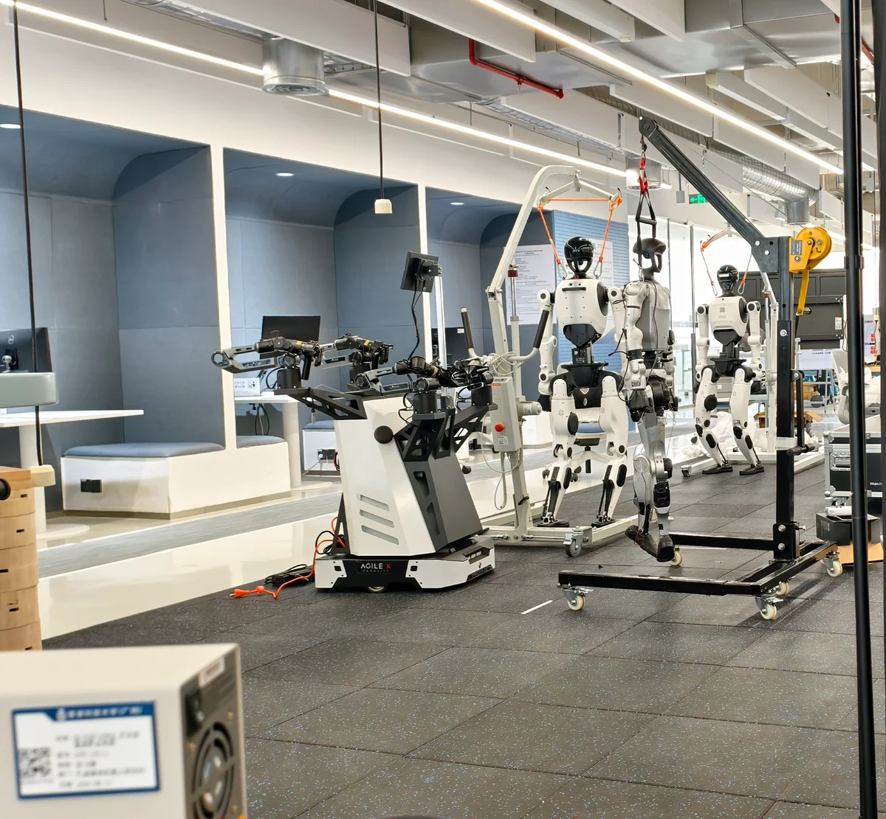
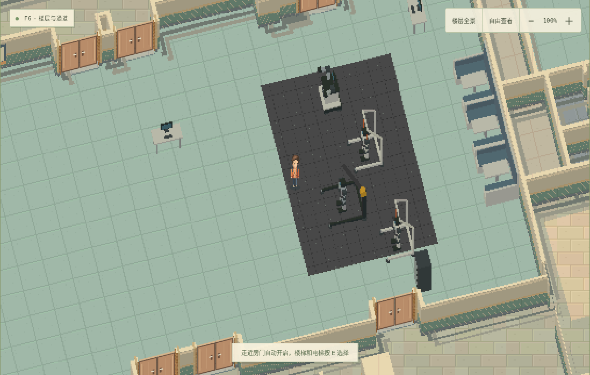
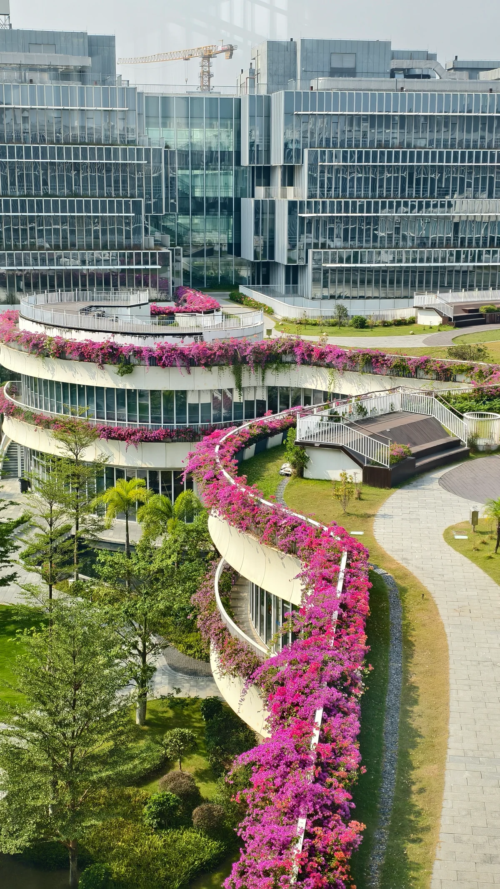
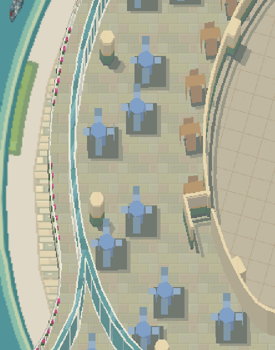
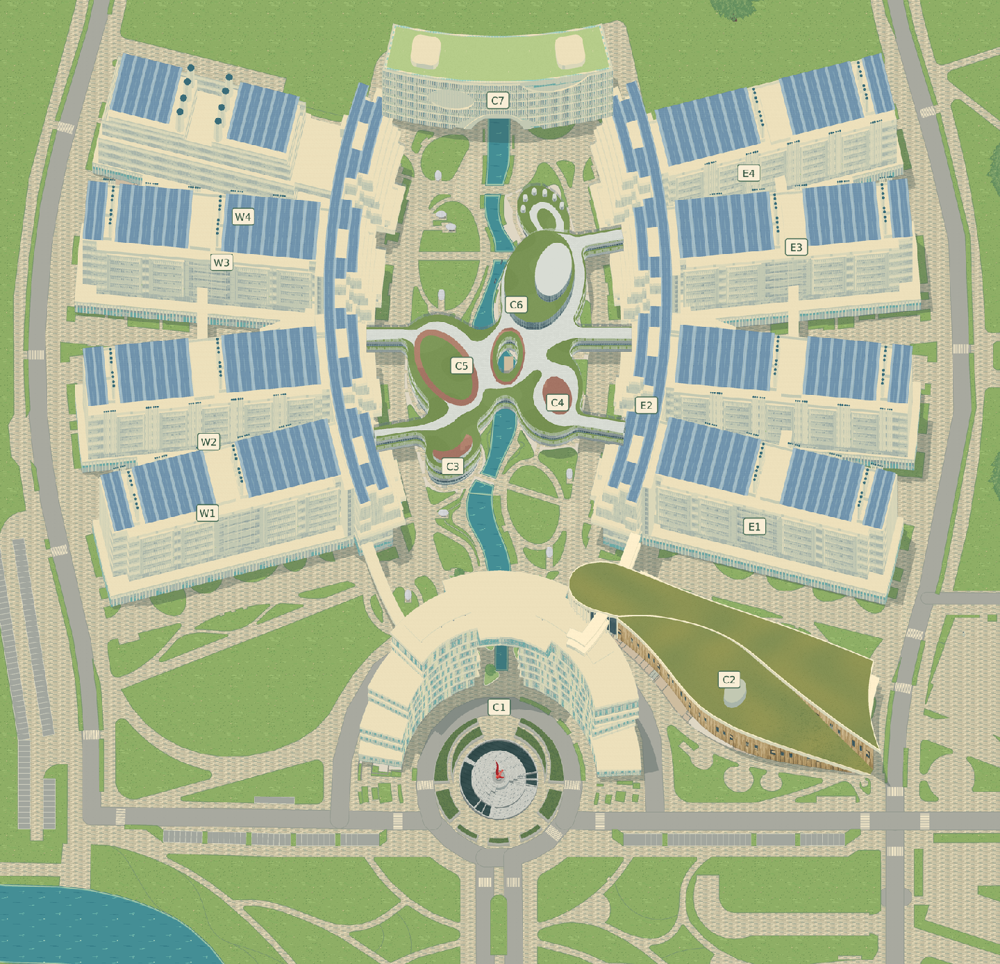
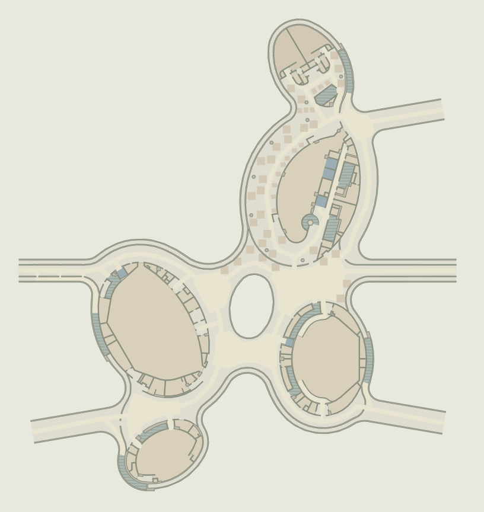
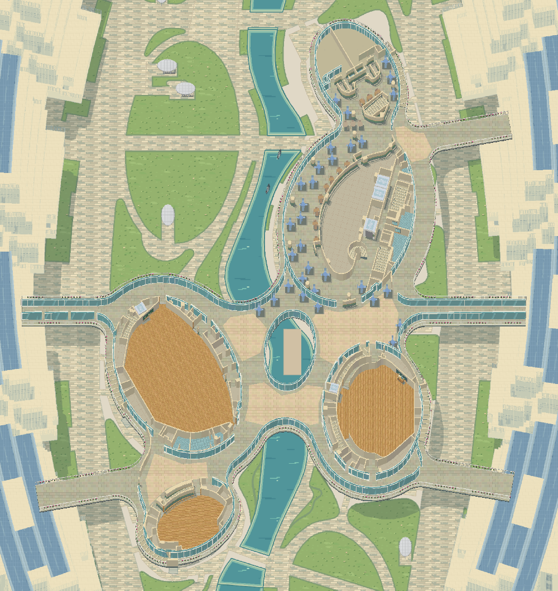
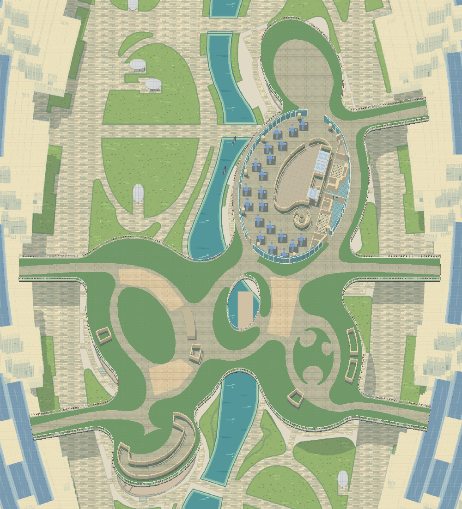

<div align="center">

# 科大谷 · USTValley

**用真实地图搭起校园，用实景照片让它不断生长。**

香港科技大学（广州）的立体像素校园：上传照片、标注位置与朝向，让 Agent 把看得见的建筑细节、物品和装饰逐步重建到地图中。

[照片 → 像素场景](#照片--像素场景) · [如何参与重建](#如何参与重建) · [真实地图底座](#真实地图底座) · [当前进度与入口](#当前进度与入口)

</div>

USTValley 希望把校园变成一张可以共同补充、持续更新的像素地图。真实校园地图提供建筑位置、楼层轮廓和通行关系；大家拍下的实景照片补充玻璃、栏杆、桌椅、机器人、绿植等现场细节。Agent 将这些线索转化为场景中的模型、材质和物件，再经过画面对照与通行检查交付审核。

先让物品出现在合理的地方、让人一眼认得出来，再用更多照片修正位置、比例和朝向。每次上传，都可以为校园地图补上一小块真实生活。

## 照片 → 像素场景

### W1：把照片里的机器人和卡座放进地图

一张实验区域照片，提供了地垫、人形机器人、双臂移动机器人、保护支架、吊架、工作台和蓝色卡座等线索。Agent 逐项识别这些物品，制作像素化构件，布置到对应楼层，并为实体物件加入碰撞与遮挡。

<table>
  <tr>
    <th width="50%">上传的实景照片</th>
    <th width="50%">Agent 生成的像素场景</th>
  </tr>
  <tr>
    <td></td>
    <td></td>
  </tr>
</table>


### C3–C6：从实景中补足建筑质感

校园照片也用来校对建筑表面和空间层次：曲线露台、内侧玻璃幕墙、外侧白色栏杆，以及局部边缘的花带。重建会区分照片中不同位置的材料，例如二楼中央椭圆区域应为连续玻璃幕墙，不能把其他露台的花带铺到这里。

<table>
  <tr>
    <th width="50%">校园实景参考</th>
    <th width="50%">像素地图中的材质与层次</th>
  </tr>
  <tr>
    <td align="center"></td>
    <td align="center"></td>
  </tr>
</table>

_这里是建筑特征与材质的不同视角对照。现有建筑细化展示了实景参考的作用，照片采集与 Agent 流程将这种更新方式扩展到更多地点。_

## 如何参与重建

**走到地点或在地图选点 → 确认楼层与拍摄朝向 → 上传实景 → Agent 重建 → 校对后更新地图**

1. **告诉地图你在哪里拍摄。** 使用角色当前位置，或在校园／楼层地图上选点，确认楼层和镜头朝向。点位标注的是拍摄者位置。
2. **上传照片，补充现场信息。** 可上传 JPG、PNG、WebP、HEIC/HEIF。多角度照片和简单说明，有助于判断物品、材质与相对位置。
3. **由 Agent 制作场景更新。** 维护者导出带位置与方向的资料包，交给项目专用的 `ustvalley-photo-rebuild` skill。Agent 对照现有地图，生成或调整建筑表面、家具、设备和装饰，并同步局部碰撞与遮挡。
4. **逐步完善。** 重新构建地图，对照修改前后的画面，检查落地、穿墙和通行。

所有照片任务统一进入 `photo-rebuild/review` 审核，不按照片或批次另开分支；各批次的提交、验证结果与采用状态仍分别记录。

## 真实地图底座

照片中的物品需要有地方落脚。USTValley 先依据香港科技大学（广州）的校园地图、楼层平面与建筑模型，重建建筑体量、道路、水体、绿地和连廊；再通过正交投影、光照与像素材质表现高低层次。



_建筑位置、朝向和主要轮廓依据源地图与模型重建。点击图片可查看大图。_

| 建筑组 | 建筑编号 | 源楼层 | 室内场景 |
| :---: | :---: | :---: | :---: |
| **6 组** | **15 个** | **31 层** | **33 个** |

### 从楼层平面到立体像素

各楼层提取自己的楼板、墙线、房间、通道与中庭孔洞，再构建墙体侧面、楼梯和设施体积。以下为 **C3–C6 学术研究中心二楼** 的同坐标对照：椭圆开口、曲线边界与连廊保持对应。

<table>
  <tr><th width="50%">源几何平面</th><th width="50%">立体像素重建</th></tr>
  <tr>
    <td></td>
    <td></td>
  </tr>
</table>

_左图由保留的源几何重绘，并非原地图网站截图；右图是基础地图的楼层渲染产物。_



_不同楼层拥有各自的轮廓和标高，室内图保留周边校园作为背景。玻璃分格、栏杆高度、地面纹理和物件侧面共同表达空间层次。_

### 覆盖范围

| 建筑 | 编号 | 覆盖楼层 |
| --- | --- | --- |
| 东科研楼 | E1–E4 | F1–F6 |
| 西科研楼 | W1–W4 | F1–F6 |
| 行政办公楼 | C1 | F1–F8 |
| 学生活动中心 | C2 | F1–F2 |
| 学术研究中心 | C3–C6 | F1–F3 |
| 图书馆 | C7 | F1–F6 |

东、西科研楼的一层按分离翼楼组织，31 个源楼层生成 33 个室内场景；加上室外校园，共 34 个地图场景。当前重点是核心教学科研区域，尚未完整重建停车场和体育馆。建筑轮廓以源数据为依据，局部材质和陈设包含照片参考与美术估计，持续接受现场校对。

## 当前进度与入口

**main 提供基础校园地图；照片采集与 Agent 重建已完成真实照片演练，场景更新统一汇入共享分支 `photo-rebuild/review` 审核。** 相关工具和场景更新仍在共享审核分支中，尚未自动合入 main。

| 内容 | 入口 |
| --- | --- |
| 基础地图与生成代码 | 当前 `main` 分支 |
| 照片上传、私有资料库及部署说明 | [photo-rebuild/review](https://github.com/JStone2934/USTValley/tree/photo-rebuild/review) · [使用说明](https://github.com/JStone2934/USTValley/blob/photo-rebuild/review/docs/photo-reconstruction.md) |
| Agent 重建工作流 | [ustvalley-photo-rebuild / SKILL.md](https://github.com/JStone2934/USTValley/blob/photo-rebuild/review/skills/ustvalley-photo-rebuild/SKILL.md) |
| W1 最新场景校正 | [photo-rebuild/review](https://github.com/JStone2934/USTValley/tree/photo-rebuild/review) · [图文记录](https://github.com/JStone2934/USTValley/blob/photo-rebuild/review/docs/w1-open-floors.md) |

### 运行基础地图

需要 Node.js 24。在 `main` 分支执行：

```bash
npm ci
npm run dev                   # 生成地图并启动开发预览
npm run maps:verify           # 重新生成并逐字节核对地图产物
npm run build                 # 校验地图、类型检查并构建网站
```

照片采集需使用上述共享审核分支并启动照片服务，具体步骤见对应使用说明。维护者导出资料包后，可向执行端 Agent 发出：

> 使用 $ustvalley-photo-rebuild，处理这份照片资料包，将可辨认的建筑细节、物品和装饰更新到对应场景，完成验证并汇入共享审核分支 photo-rebuild/review。

更多资料：[地图重建报告](docs/map-reconstruction-report.md) · [构建记录](content/map-build-report.json) · [实景参考](docs/campus-photo-references.md) · [全部室内场景](public/maps/interior-catalog.png)。

## 素材与展示说明

校园几何与原始模型来自项目保存的校园地图资料；像素纹理、材质及补充物件由项目制作。原地图、模型与派生美术的来源及复用状态见 [素材清单](content/assets.json)。

本页实景照片由维护者提供并指定用于 README 对照，发布的是压缩展示副本，不含 EXIF；这不改变其他上传照片默认私有的规则。游戏截图展示真实重建产物，早期演示与后续修正版分别标注。图片来源、处理方式与更新方法见 [图片目录](docs/images/README.md)。
