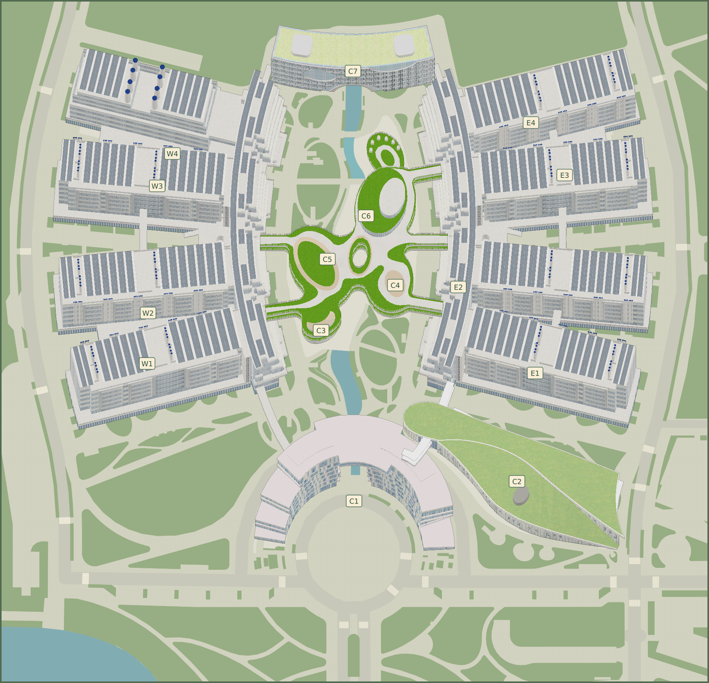
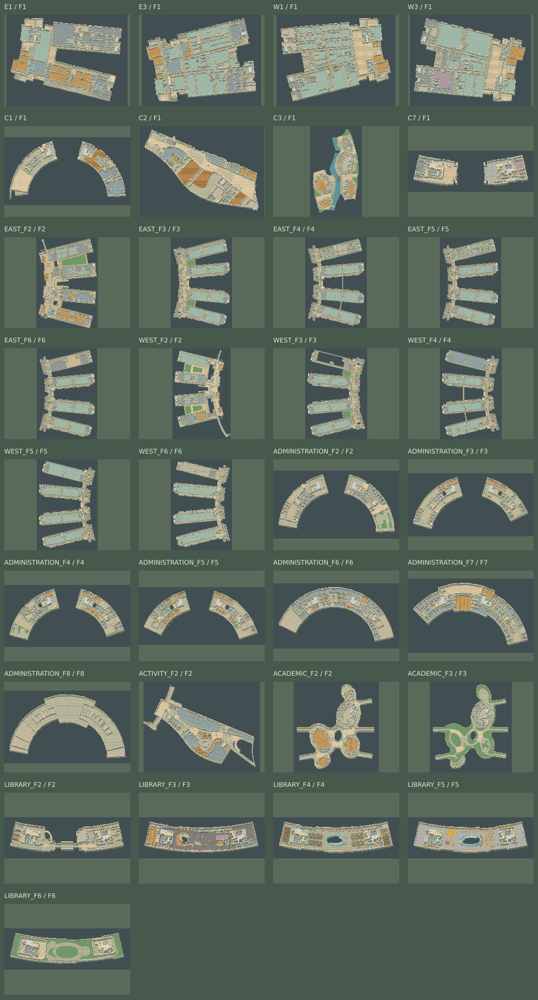

# 科大谷 USTValley

当前版本 **0.5.8** 可探索六组核心建筑、33 个室内场景和室外校园。地图按原楼层、标高、建筑轮廓与模型放置坐标重建。单机模式支持键盘和触屏。鼠标滚轮缩放，左键或中键拖动地图进入自由查看；点击「回到角色」或按 C 恢复跟随。自由查看时角色仍可用键盘或摇杆移动；点击地图只移动镜头。室外「校园全景」完整展示校园并可按建筑名称定位，点击全景拉近查看；室内提供「楼层全景」。

**3D 环视**　室外点击「3D 环视」加载真实三维建筑与设施。左键拖动旋转 360° 并调整俯仰，右键或 Shift＋左键平移，滚轮缩放；触屏单指旋转、双指平移缩放。校园全景、建筑定位、点击位置、C 回到角色均可用。角色按镜头方向行走，保留原有墙体碰撞和出入口判定；进入建筑后自动返回室内漫游。当前三维环视仅提供室外校园，室内保持原有立体像素视角。

活动中心的竹色金属外墙、学术研究中心的架空连廊、红鸟广场和图书馆的局部设施均已对照建成实景。参见[照片和地图物件对照](docs/campus-photo-references.md)。



**可走的路线**　从 C2 入口走进学生活动中心，可乘电梯或走楼梯到 F2，再沿连廊进入行政楼。游戏连接 393 对楼梯、电梯及扶梯、15 对同标高跨楼连廊和 47 对一层建筑出入口。1120 间有原始门口记录且可达的房间共装有 1504 扇可操作门。走向房门会自动开门，两侧都可通行，离开后自动关门。图书馆书架、源座椅和新增的贴墙柜台都有占地碰撞。走到红鸟广场的跨水石道或日晷基座旁，按 E 或点「观察红鸟日晷」可查看现场说明。

东翼 F4 的 403 房间现可经 401 双门会议室和西侧走廊进入。转角门洞按原始墙端净宽设置斜向通道；角色移动逐段检查完整身体占地，家具也避让门口和落脚区域。

**近景画面**　地图美术按每个逻辑像素 3×3 个实际像素重新烘焙。屋顶、墙体、楼板、家具和人物采用 0.74 高度投影。人物经过墙、柜台或书架后方时，前景按真实可见表面的高度遮挡人物。室内按地点原名选用木板、石材、湿区瓷砖或实验室地材，室外有河岸、绿化屋面、光伏板与红鸟广场。贴墙讲台、实验台和边柜为按房间用途推断的美术陈设，门口、墙线、楼梯和跨楼交接点来自地图包。

**镜头与比例**　人物身高 1.75 米，体宽 0.50 米。默认镜头按可见画布高度取景，桌面人物约占 8.75%，手机横屏约占 7.5%。可用画面右上角的 ＋／－ 调整视野，进出建筑时保留相对远近。详见[角色比例说明](docs/character-scale.md)。



## 启动

需要 Node.js 24，版本及依赖已锁定：

```bash
npm ci
npm run dev
```

打开 `http://localhost:3000`。同一局域网可访问 `http://<本机局域网IPv4>:3000`，各浏览器当前为独立单机预览。

这台机器的 Node 24.22.1 在 `$HOME/.local/share/ustvalley-node/bin`，可直接使用启动脚本：

```bash
./scripts/dev.sh
./scripts/dev.sh --port 3001  # 如需其他端口
```

WASD／方向键移动，按住 Shift 奔跑（基础速度的 2 倍），松开恢复基础速度，走向门槛自动进出建筑，E 手动交互，M 打开真实校园总览，Esc 关闭面板；手机使用摇杆和交互键。校园外墙按一层轮廓阻挡行走。走到真实门槛会自动进出楼，贴墙经过门口仍在原场景。屋檐遮住人物时仅剖开脚下附近的区域。室内斜墙、玻璃及细隔断按逐像素轮廓挡脚。跨楼时沿同层连廊走过交界点即进入相邻建筑。走向房门时门扇绕门铰打开，走离后关上。也可以按 E 或点击门名手动开关。蓝色图标为电梯，绿色台阶图标为楼梯／扶梯，标注通往楼层；靠近后按 E，或点击“上楼至／下楼至”按钮选择方向。进入建筑后，漫游画面与地图面板只显示角色当前楼层平面，上下楼后自动同步；室外校园总览可预览各建筑楼层。地图支持单独显示／隐藏地面、房间、通道、设施及墙体。场景按需加载并释放上一场景纹理。

## 解包与重建

```bash
npm run maps:unpack   # 校验125项下载，拆出9图所有图层和70个GLB
npm run maps:build    # 从几何重建规则、碰撞、模型图像及Tiled产物
npm run maps:inspect  # 导出已烘焙的全部3D楼层图、源平面及公共通行检查图
npm run maps:orbit   # 单独更新三维校园资产（完整重建也会生成）
npm run maps:verify  # 重建并逐字节检查现有产物
```

完整方法、源数据统计、坐标和高度处理、入口误差及限制见 [详细解包与重建报告](docs/map-reconstruction-report.md)。

| 产物                                              | 用途                                                     |
| ------------------------------------------------- | -------------------------------------------------------- |
| `data/unpacked/inventory.json`                    | 9 张地图、34 个楼层键、471 层、70 个模型的详细清单       |
| `data/unpacked/maps/<地图>/<楼层>/<图层>.geojson` | 保留源属性及孔洞的逐层几何，供本地核对                   |
| `data/unpacked/models/<模型哈希>/scene.gltf`      | 可单独打开的解包模型，同目录含 buffer 与独立贴图         |
| `data/unpacked/previews/`                         | 全部室内楼层平面及碰撞连通检查图                         |
| `content/map-config.json`                         | 坐标变换、编号依据、显式入口及重建参数                   |
| `content/map-build-report.json`                   | 源 SHA-256、模型变换、实际高度、烘焙信息及逐入口误差     |
| `public/maps/campus-labeled.png`                  | 带 15 个编号的完整重建图                                 |
| `public/maps/campus-reconstruction.png`           | 无标注重建图                                             |
| `public/maps/building-*.png`                      | 六组实际模型的透明背景烘焙                               |
| `public/maps/floor-*.png`                         | 各真实楼层／F1 翼楼的 3D 像素室内图                      |
| `public/maps/world.json`                          | 共享规则、源几何和 4px 碰撞产物                          |
| `public/maps/*.tmj`                               | 34 个 Tiled 地图；独立图像层、源图层及孔洞、4px 碰撞对象 |

`data/unpacked` 为可重新生成的本地资料，不纳入源码和网站发布。原 `.bin` 封装保留并校验，本次没有重新解码其未知封装；几何解包使用仓库已有的 `all-maps.json`，详见报告。

前端只发布整理后的规则和烘焙 PNG，不公开原始 GLB、独立源贴图文件、定位信标和下载清单。开发服务也拒绝访问整个 `data`。不要使用无访问限制的仓库根目录静态服务器。

`.tmj` 当前是生成产物，手工修改会被覆盖。地图内容变化须更新 `mapVersion`。`maps:release` 仍保留正式阶段检查：建筑已依据源数据重建，但自动关联的编号入口仍需现场核实，未确认前该命令按预期失败。

## 验证与构建

```bash
npm run typecheck
npm test
npx playwright install chromium
npm run test:e2e
npm run build
npm run preview
```

`preview` 提供静态构建，默认端口 3000，不要与开发服务占用同一端口。浏览器测试使用端口 4317。

测试覆盖 3D 多边形孔洞、墙体挤出及遮挡顺序、逐级台阶、全部 33 张室内渲染产物，以及全部 70 个模型的解码、节点实例及负缩放、Accessor 偏移与步长、高度恢复、Polygon 孔洞、入口可达性、精确 Tiled 碰撞导出，全部31个室内楼层与393条跨层连接的校园可达性，以及真实 C2 平面上的探索、扶梯换层往返、暂停、失焦、触摸取消和图像重试。截图生成在 `test-results/`。真机和多人验收尚未执行。

实现状态见 [实施记录](docs/implementation-status.md)，素材来源见 `content/assets.json`。

### 三维环视资产

`public/orbit/campus.glb` 是从六组建筑和 18 个设施模型生成的本地坐标网格，共 46,839 个三角形，保留内嵌颜色与纹理，不包含原始地理坐标、路径或自定义元数据。`terrain.png` 由已烘焙地面图层合成，去除固定方向的阴影，由实时光照重新投影。`maps:verify` 同时验证这些产物。Three.js 按需加载；加载失败或设备不支持 WebGL2 时，可返回原漫游。
