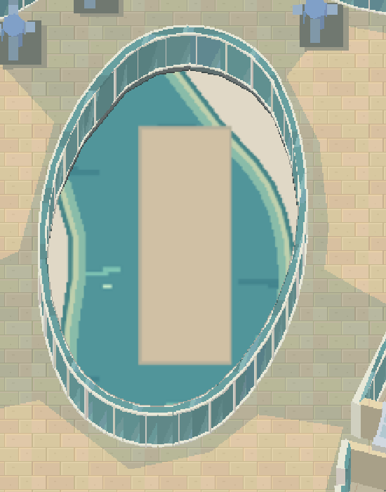
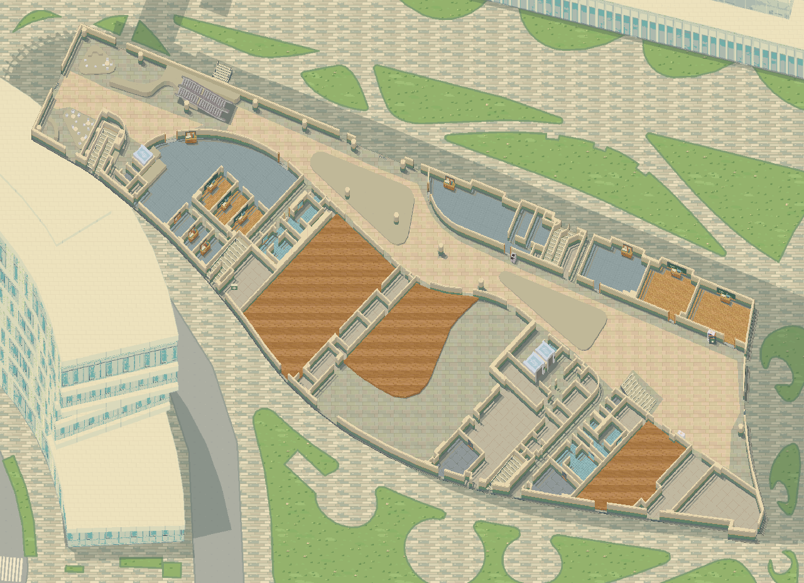
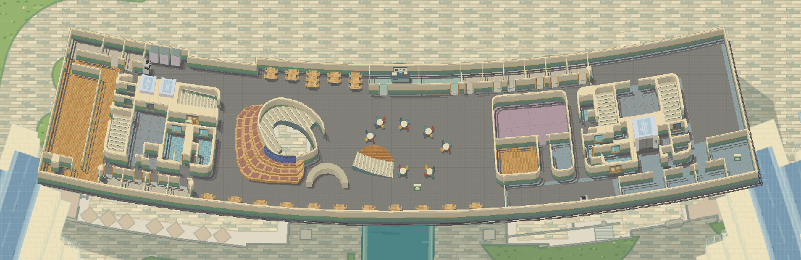

<div align="center">

# 科大谷 · USTValley

**从真实校园地图出发，重建一座立体像素校园。**

香港科技大学（广州） · 核心校园地图重建

[校园全景](#校园全景) · [从平面到像素](#从平面到像素) · [楼层与材质](#楼层与材质) · [重建范围](#重建范围)

</div>

## 校园全景

科大谷以香港科技大学（广州）的校园地图、楼层平面与建筑模型为基础，把建筑体量、弧形连廊、道路、水体和绿地转译为统一的像素画面。重建保留校园原有的空间关系，让科研楼的翼楼、学术环的中庭、图书馆的绿色屋面，都能在像素尺度下被辨认。


_核心校园全景。建筑位置、朝向和主要轮廓依据源地图与模型重建；点击图片可查看大图。_

|  建筑组  | 建筑编号  |  源楼层   | 室内场景  |
| :------: | :-------: | :-------: | :-------: |
| **6 组** | **15 个** | **31 层** | **33 个** |

## 从平面到像素

每个楼层都从自己的平面开始：提取楼板、墙线、房间、中庭孔洞和通道，再构建墙体侧面、楼梯踏面与设施体积。建筑模型沿用源数据中的放置位置与方向，并恢复竖向尺度；最终通过正交投影、方向光和像素材质，形成有高低层次的画面。

下面是 **C3–C6 学术研究中心二楼** 的同坐标对照。椭圆开口、曲线边界、展厅和连廊在两张图中保持对应。

<table>
  <tr>
    <th width="50%">源几何平面</th>
    <th width="50%">立体像素重建</th>
  </tr>
  <tr>
    <td></td>
    <td></td>
  </tr>
</table>

_左图由保留的源几何重新绘制，并非原地图网站截图；右图是项目当前使用的楼层渲染产物。_

重建时重点保留三类信息：

- **平面形状**：建筑曲线、房间边界、露台与中庭孔洞。
- **空间关系**：建筑之间的位置、同层连廊、各层平面与标高。
- **建筑特征**：屋面起伏、光伏板、玻璃立面、楼板边缘与已记录的设施。

## 楼层与材质

### 同一座学术环，不同的楼层轮廓

二楼的展厅、房间和连廊，与三楼的屋顶绿地、开放露台形成不同的空间。楼层依据各自的源平面重建；室内图同时保留周边校园作为背景，让剖开的建筑仍处在可辨认的校园环境中。


_学术研究中心 F3。室外景色根据源坐标对齐，并随楼层标高调整远景位置。_

### 玻璃、栏杆与曲线边缘

参照建成后的校园照片，内侧幕墙使用蓝绿色玻璃、细白框与反光分格；临空露台使用较低的白色竖杆栏杆。局部外缘加入三角梅花带。二楼中央的椭圆区域则保留为连续玻璃幕墙。

<table>
  <tr>
    <th width="50%">中央椭圆玻璃幕墙</th>
    <th width="50%">内幕墙与外栏杆</th>
  </tr>
  <tr>
    <td></td>
    <td></td>
  </tr>
</table>

_材质沿实际边线铺设。玻璃分格、栏杆高度和像素纹理共同表现空间层次。_

### 把楼层内部也画出来

室内保留房间与走廊的实际轮廓，并按地点用途区分木地板、石材、瓷砖和其他地面材质。墙体、楼梯、书架与桌椅具有可见侧面，纹理尺度随空间比例调整。



_C2 学生活动中心 F1。木地板、浅色铺装与房间地材在同一楼层中形成清晰的区域差异。_



_C7 图书馆 F3。馆内局部阶座与配色参考公开实景资料，保持原有楼层轮廓。_

## 重建范围

目前展示范围集中在校园的核心教学科研区域：

| 建筑         | 编号  | 覆盖楼层 |
| ------------ | ----- | -------- |
| 东科研楼     | E1–E4 | F1–F6    |
| 西科研楼     | W1–W4 | F1–F6    |
| 行政办公楼   | C1    | F1–F8    |
| 学生活动中心 | C2    | F1–F2    |
| 学术研究中心 | C3–C6 | F1–F3    |
| 图书馆       | C7    | F1–F6    |

六组建筑共包含 **31 个源楼层**。东、西科研楼的一层按分离翼楼组织，生成 **33 个室内场景**；加上室外校园，共 **34 个地图场景**。

建筑位置、平面轮廓与孔洞以源数据为依据。铺装纹理、玻璃反光、部分花带和室内陈设包含照片参考与美术推定；部分入口关联及陈设仍待现场核对。当前重建范围不包含停车场和体育馆的完整场景。

## 地图如何生成

地图重建从结构化校园数据与模型出发，经过坐标对齐、楼层拆分、几何构建和像素渲染，输出完整楼层图与分层图像。展示图均来自这一流程的产物。

```bash
npm ci                         # 需要 Node.js 24
npm run maps:build             # 重建校园与各楼层地图
npm run maps:verify            # 重新生成并逐字节核对产物
npx tsx scripts/build-readme-images.ts  # 更新本页展示图
```

- [地图解包与重建报告](docs/map-reconstruction-report.md)：源数据、模型、坐标和楼层处理方法，含早期版本记录。
- [当前地图构建记录](content/map-build-report.json)：逐场景来源、模型信息和渲染校验值。
- [校园实景与地图物件对照](docs/campus-photo-references.md)：建筑与室内细节的实景参考。
- [全部室内场景总览](public/maps/interior-catalog.png)：33 个室内场景的缩略图合集。

## 素材来源

校园几何与原始模型来自项目保存的校园地图资料；像素纹理、部分材质和补充陈设由项目制作。原地图、模型与派生美术的来源及复用状态分别记录在 [素材清单](content/assets.json) 中。

本页图片为当前重建结果的缩放或局部裁切，源几何对照图另行重绘。展示图的生成说明见 [图片目录](docs/images/README.md)。
