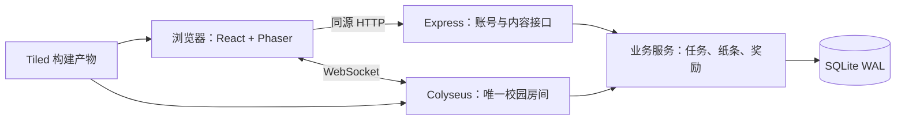

# 科大谷（USTValley）v1.0 游戏设计与技术方案

- 版本：1.0
- 日期：2026-10-26（Asia/Shanghai）
- 状态：设计基线，待实施与验证
- 目标：在本机部署、通过局域网网址访问的多人像素校园探索游戏
- 本次交付：设计文档；不包含游戏代码、素材制作或服务部署

## 1. 产品目标与需求边界

《科大谷》以香港科技大学（广州）的真实建筑和道路关系为基础，采用温暖的俯视像素美术。玩家注册后进入同一座校园，探索建筑、寻找共享宝箱、阅读和留下纸条，通过探索币和成就解锁角色外观。首版的价值是“认得出自己的校园，而且能和其他人一起留下痕迹”。

### 1.1 已确认需求

| 项目 | v1.0 决策 |
|---|---|
| 地图 | E1—E4、W1—W4、C1—C7，共 15 个编号建筑，以及连接道路、庭院和公共空间 |
| 边界 | 按核心建筑群界定，排除外围；不按学生活动中心经度直接切图，以免裁掉 E 区 |
| 室内 | 每个编号建筑均可进入，至少一个简化室内，不还原全部楼层 |
| 风格 | 保留真实地标辨识度，采用星露谷式温暖俯视像素表现，独立制作素材 |
| 多人 | 公共校园与共享探索内容；宝箱定时刷新，先领取者获得奖励 |
| 交流 | 公开纸条、点赞、举报；不做即时聊天 |
| 成长 | 探索任务、宝箱、纸条任务；奖励用于外观和探索成就 |
| 平台 | 电脑和手机浏览器 |
| 部署 | 本机服务器，局域网内约 5—20 人试玩 |
| 后续扩展 | 保留用户发布与响应任务的扩展位置，首版只开放系统任务 |

不纳入 v1.0：种植、作物生长、钓鱼、私人房间、家具装饰、战斗、交易、私聊、即时公共聊天、校园统一身份认证、全部楼层、全校园及公网正式运营。这里的“共享校园”指共享场景、宝箱和留言，不包含玩家自由编辑校园地形。

### 1.2 默认设计参数

以下为方案默认值，不是用户逐项指定的要求。统一放入版本化配置，调整奖励和内容数量不应要求修改核心程序。

| 参数 | 默认值 |
|---|---|
| 最大同时在线 | 20 人，一个持久世界、一个权威房间 |
| 基础瓦片／角色 | 16×16／16×32 像素 |
| 移动 | 64 逻辑像素/秒，八方向输入、四方向动画，斜向速度归一化 |
| 服务端步进／状态同步 | 20 Hz／10 Hz；客户端独立渲染并插值 |
| 交互半径 | 24 逻辑像素，同时检查场景和阻隔 |
| 宝箱 | 12 个固定点，每次领取 10 探索币，领取后 30 分钟刷新 |
| 纸条 | 140 个 Unicode 码点、每人最多 10 条未删除纸条、发布间隔 60 秒 |
| 保存与重连 | 位置每 10 秒保存；断线保留名额 30 秒 |
| 初次体验 | 约 15—30 分钟完成一轮探索、留言和外观解锁 |

## 2. 源资料与地图重建

### 2.1 已检查的资料

当前项目尚无游戏代码，地图资料位于 `data/maps`。`all-maps.json` 包含 9 张地图的结构化数据；`project-config.json` 包含地图名称、编号和楼层；下载清单记录资源来源与校验值。资料 README 记录 70 个 GLB、54 张图片/图标及一个原始包，共 125 项下载资源。

总图中的几何声明使用 EPSG:3857；存在道路、入口和建筑模型变换信息。数据也包含定位信标等与游戏无关的内容，不应直接整体发布。现有资料是布局与外观依据，不是可直接运行的像素游戏地图。本次未重新执行完整文件哈希校验，也未逐个渲染 GLB。

| 游戏地标 | 对应源地图 | 使用方式 |
|---|---|---|
| 室外校园 | `xgkdgz_all` | 道路、建筑位置、公共空间、入口和外观参考 |
| E1—E4 | `xgkjdxaz_dkyl` | 东科研楼建筑群及室内参考 |
| W1—W4 | `xgkjdgz_xkyl` | 西科研楼建筑群及室内参考 |
| C1 | `xgkdgz_xzbgl` | 行政办公楼参考，实施时核对总图编号和入口 |
| C2 | `xgkdgz_xshdzx` | 学生活动中心 |
| C3—C6 | `xgkjdgz_xsyjzx` | 学术研究中心建筑群、演讲厅参考 |
| C7 | `xgkdgz_tsg` | 图书馆 |

地下停车场、体育馆及其他外围区域不作为首版可游玩内容。E/W/C 建筑群可能共用模型；“15 个室内”是游戏内容要求，不代表源数据已提供 15 份独立可导入场景。

### 2.2 从真实地图到游戏地图

1. 提取核心建筑、入口、道路和边界，产出带 E/W/C 编号的可视底图。源坐标和属性仅保留必要字段。
2. 选核心区固定原点，执行平移、统一缩放和 Y 轴翻转；如需让校园主轴更易阅读，使用记录在配置中的统一旋转。保存原点、比例、旋转和源数据版本，保证转换可重现。
3. EPSG:3857 的投影单位不直接当作实际步行距离。以道路连通、建筑相对顺序和地标识别为优先，人工缩短重复走廊和空白路段；记录人工调整，不能再假定整张游戏图严格对应一个地理比例。
4. 在 Tiled 制作有限正交地图。首版室外建议控制在 256×256 瓦片以内，室内各不超过 64×64；若底图超出预算，优先压缩空白区域，不裁掉已确认地标。
5. 按建筑编号配置 15 个入口与室内场景。源数据无法明确区分的入口，在灰盒阶段依据平面图和 GLB 人工核对；不得将推测入口标为精确实测。
6. 从同一地图构建产物导出客户端图层与服务端碰撞、入口、探索区、纸条区、宝箱点。构建时验证 ID 唯一、引用完整和点位可达。
7. 在客户端只发布经过整理的像素素材与游戏地图。原始 JSON、定位数据、GLB 和下载清单保留在开发目录。

地图内容必须带 `mapVersion`。客户端连接时验证协议与地图版本，版本不一致提示刷新；服务器从地图配置验证出生点和存档位置，失效位置回退至安全出生点。

### 2.3 场景、入口与探索点

- `campus_core`：共享室外，出生点设在 C2 附近安全广场，设置清晰导览牌。
- `interior_e1` 至 `interior_e4`、`interior_w1` 至 `interior_w4`、`interior_c1` 至 `interior_c7`：15 个独立逻辑场景。场景仍属于同一个多人房间，同场景玩家互相可见。
- 每栋建筑以进入室内并到达探索触发区作为首次发现条件。界面展示已探索数量和建筑编号，避免只靠远距离加载即获得奖励。
- 所有入口设置配对出口；多个入口进入时记录来源入口，离开时返回对应室外点。资料不足的建筑首版只开放一个明确入口。
- 室内采用“入口＋辨识性大厅／展区＋探索点”的最小结构。图书馆保留书架与阅读空间，活动中心保留活动展示，科研楼保留公共走廊和研究展示，行政与学术区域保留大厅与导览信息；不模拟真实受限房间。
- 核心区边界使用绿篱、围栏或未开放道路表现，不能让玩家走到空白图外。屋顶和前景采用脚底 Y 排序，靠近入口时适当淡化遮挡。

图层至少包含：`ground`、`decoration`、`collision`、`foreground`、`portals`、`exploration`、`note_zones`、`chests`、`spawns`。道路数据辅助确定通行关系，最终碰撞以游戏地图为准。

## 3. 美术、界面与操作

采用有限暖色调、清晰像素轮廓、柔和阴影。用外形比例、连廊、屋顶与标识区分建筑，避免把真实科研楼统一改成乡村木屋。首版固定日间光照，暂不引入昼夜逻辑。

- 基础瓦片 16×16；角色 16×32，每个方向至少待机 1 帧、行走 4 帧。帽子使用与角色动作对应的锚点，不只覆盖一张静态贴图。
- 渲染关闭平滑，使用最近邻采样；优先整数倍缩放，通过改变可见逻辑视野适配屏幕，避免非整数拉伸。建筑可以跨多个瓦片。
- 最小素材清单：地面/路面/水体/绿化瓦片集、15 个编号建筑的可辨识外观、按建筑用途复用的室内瓦片集、角色、3 款帽子、3 套可解锁配色、宝箱开闭状态、纸条标记与交互图标。
- 角色外观完全装饰性。相同建筑群可以复用构件，但编号、入口与主要轮廓应可识别。
- 每份素材记录作者、来源、许可和版本；使用独立绘制或明确可使用的素材，不提取《星露谷物语》的原始角色、贴图和音乐。

主界面显示角色昵称、探索币、任务入口、地图入口、外观入口和当前可交互目标。小地图只展示开放区域、玩家位置及已发现地标，不实时揭示所有宝箱状态。聊天输入框不出现在首版界面中。

| 设备 | 操作 |
|---|---|
| 电脑 | WASD／方向键移动，E 与最近可交互对象互动，Esc 关闭面板；纸条和外观通过鼠标操作 |
| 手机 | 左侧虚拟摇杆，右侧交互键，触摸打开面板；按钮触控区域至少 44 CSS 像素 |
| 文字输入 | 表单聚焦、弹窗开启时清零移动输入；中文输入法组合期间不触发游戏快捷键 |

手机游戏画面以横屏为主，竖屏显示旋转提示，不依赖浏览器强制锁屏功能。登录和纸条输入适配竖屏、软键盘与安全区域。页面失焦、触摸取消或进入后台立即停止本地输入；服务器超过 250 毫秒未收到输入后也停止角色移动。

资源按场景加载，缓存通用瓦片集；加载失败保留重试按钮，未经完成加载不显示可操作状态。切换室内时显示短暂遮罩，在客户端准备完成、服务端确认切换后恢复操作。

## 4. 玩法规则与经济

### 4.1 新玩家路径

注册账号 → 设置昵称和免费基础配色 → 在 C2 广场出生 → 学习移动与交互 → 探索 C2 → 留下第一张纸条 → 沿导览探索其他建筑 → 寻找宝箱 → 解锁外观。

宝箱有竞争性，但初始体验不能依赖抢到宝箱。地标和首次纸条任务提供稳定奖励，使后来加入的玩家仍能完成外观解锁。

### 4.2 初始任务与奖励

| 内容 ID | 完成条件 | 默认奖励 | 重复性 |
|---|---|---|---|
| `discover:{buildingId}` | 首次进入对应建筑探索区 | 每栋 5 币 | 每账号每栋一次 |
| `first_chest` | 首次成功领取任意宝箱 | 额外 5 币 | 每账号一次 |
| `first_note` | 首次成功发布合规纸条 | 5 币 | 每账号一次 |
| `explore_5` | 探索 5 栋建筑 | 「校园访客」称号 | 每账号一次 |
| `explore_15` | 探索全部 15 栋 | 「科大漫游者」称号 | 每账号一次 |

任务自动接取、自动结算，没有额外的“领取奖励”步骤。删除纸条不重置已完成任务，点赞不产币。隐藏或删除纸条不撤销普通任务奖励，滥用由管理功能处理。

外观商店首版配置 3 套额外配色、每套 10 币，以及 3 款帽子、价格分别 20/30/40 币。已拥有的外观不可重复购买；扣币和解锁在同一事务中完成。基础配色免费，称号通过成就获得，货币不可转赠。

### 4.3 共享宝箱

12 个固定点默认分配为室外 8 个，C2、C7、E1、W1 室内各 1 个。精确坐标在灰盒地图中配置并通过可达性检查，不在文档中捏造地理位置。

宝箱状态由 `nextAvailableAt` 和 `generation` 表示。初始可领取；成功后写入“当前服务器时间＋30 分钟”，每一轮只允许一次领取。所有时间以服务端 UTC 时间戳存储，展示时再格式化。

领取步骤：验证会话、地图版本、场景、距离和阻隔 → 校验请求幂等键 → 条件更新宝箱状态 → 写入领取记录、货币流水及任务进度 → 提交事务 → 广播状态并返回结果。失败不扣除任何资源；并发失败者收到“宝箱已被领取”。

事务成功而回包丢失时，重发相同请求返回原结果，不再次发奖。服务重启后若已过刷新时间，宝箱恢复为一轮可领取状态，不补发停服期间的多轮奖励。刷新无需依靠仅存在内存中的定时器。

### 4.4 纸条

纸条只能在地图标记的放置区、玩家附近空闲格放置；不得覆盖出口、宝箱、探索触发点及其交互空间。纸条不参与物理碰撞，同一格最多一张可见纸条。

文本去除首尾空白后不能为空，以 Unicode 码点计数不超过 140；作为纯文本渲染，不解析 HTML、Markdown、图片或可点击外链。全站统一规范化换行，前后端执行相同长度规则。

每账号最多 10 条未删除纸条，管理员隐藏的纸条仍计入额度；作者删除后释放额度，删除内容保留管理审计记录。发布间隔 60 秒，无自动过期。阅读不要求贴近，打开某张纸条前必须已获得该场景的纸条信息；创建必须经过实时位置校验。

点赞唯一约束为 `(noteId, accountId)`，不允许自赞；再次点赞不累加，可取消点赞。举报按账号和纸条去重，附可选原因；举报不自动隐藏内容，由管理员处理。作者可删除自己的纸条，管理员可隐藏／恢复纸条并封禁账号或禁止其继续发布纸条。

## 5. 技术架构

### 5.1 选型与理由

| 层次 | 选型 | 决策理由 |
|---|---|---|
| 游戏 | TypeScript、Phaser 3、Vite | 提供 2D 场景、瓦片地图、动画及统一输入；采用成熟的 Phaser 3 路径，避免首版同时承担主版本迁移 |
| 页面 UI | React | 处理注册、中文文字输入、任务、外观与管理表单，减少 Canvas 表单适配成本 |
| 实时服务 | Node.js 24 LTS、Colyseus | 共享 TypeScript 类型，维护权威房间和同步状态 |
| HTTP | Express | 同一进程承载账号、持久内容接口与静态资源 |
| 存储 | SQLite WAL、Drizzle、better-sqlite3 | 单机低写入量部署简单；关键业务用短事务与唯一约束保障一致性 |
| 内容 | Tiled、TypeScript 转换脚本 | 人工编辑像素地图，导出客户端和服务端共用的规则数据 |
| 部署 | Docker Compose | 单个应用服务加持久化目录，方便重启、升级与备份 |

不引入 Redis、微服务、集群分片或独立数据库服务器。SQLite 单写入者的限制通过短事务、位置批量保存和不逐帧落库控制；若未来多进程共享世界或写入量扩大，再评估 PostgreSQL 等服务型数据库。

实现起始阶段验证 Node.js、Colyseus 服务端/客户端/schema、Phaser、Drizzle 和 SQLite 驱动的兼容组合，并提交锁文件；本设计不将“最新版本”作为兼容性保证。

HTTP 与 WebSocket 共用同一账号身份和业务服务，避免两套奖励、权限和位置校验逻辑。

### 5.2 同步、移动与场景

服务器维护唯一 `campus-main` 房间，创建时从数据库恢复持久世界；禁止自动创建第二个校园副本。满 20 人返回满员状态，不将新玩家隐式分配到另一个世界。断线重连名额计入上限，30 秒后释放。

客户端发送输入方向和递增序号，不提交可信坐标或移动时长。服务器按固定步长、速度上限和碰撞网格计算移动，裁剪过期与异常输入；玩家之间无碰撞。客户端预测本角色位置，根据服务端确认序号纠偏，其他角色使用插值。

单房间状态同步可以包含 20 人的轻量角色状态，客户端只渲染同场景角色。纸条正文通过分页 HTTP 请求读取，不随每次移动广播。客户端不得把其他场景的宝箱状态视为可交互授权。

切换场景时服务器验证玩家处于入口范围；加载期间不允许移动或领取。完成后设置目标安全点、返回入口和 `sceneId`。重连在原有效位置恢复；地图更新使位置失效时回到 C2 出生点。退出和优雅关闭补存位置；异常崩溃允许损失最多约 10 秒的位置变化，不允许丢失已确认奖励。

同账号第二个连接替换旧连接，使用连接代次标记拒绝旧连接的迟到请求；新会话生效前撤销旧连接的现场操作权限。

## 6. 数据、接口与任务扩展

### 6.1 持久化实体

| 实体 | 核心字段／约束 |
|---|---|
| `accounts` | ID、唯一规范化用户名、密码哈希、角色权限、封禁状态 |
| `sessions` | 哈希化会话标识、账号、过期时间、撤销状态 |
| `characters` | 账号唯一、昵称、场景/坐标、返回入口、余额、装备、地图版本 |
| `explorations` | 账号＋建筑 ID 唯一、首次发现时间 |
| `task_progress` | 账号＋任务 ID 唯一、进度、完成和结算时间、定义版本 |
| `currency_ledger` | 账号、增减金额、原因、业务来源唯一键、余额审计 |
| `cosmetic_unlocks` | 账号＋外观 ID 唯一、解锁来源 |
| `chests` / `chest_claims` | 点位 ID、代次、可领取时间；点位＋代次领取记录唯一 |
| `notes` | 作者、场景、格坐标、纯文本、状态、创建/删除时间 |
| `note_likes` / `note_reports` | 账号＋纸条唯一；举报原因和处理状态 |
| `action_receipts` | 账号＋操作类型＋请求 ID 唯一，保存关键操作结果 |
| `admin_audit` | 管理员、目标、操作、时间与原因，不保存密码和会话令牌 |

启用外键、迁移版本和合理索引。余额非负，所有金额为整数。领取、奖励、任务完成、购买等使用数据库事务，事务内不等待网络请求。纸条活动格位采用受状态约束的唯一性规则，防止同时放置重叠。

### 6.2 HTTP 边界

统一 `/api/v1` 前缀，响应失败包含稳定 `code`、可展示消息和 `requestId`。分页默认 50 条、上限 100 条；不一次向客户端返回全部纸条。

| 接口组 | 最小接口与行为 |
|---|---|
| 身份 | `POST /auth/register`、`/login`、`/logout`，`GET /me` |
| 角色 | `PATCH /me/profile`，`GET /me/progress`；昵称可重复，账号 ID 为身份依据 |
| 入场 | `POST /world/join`：校验会话、容量、版本，返回短期单次入场票据 |
| 纸条 | `GET /notes?sceneId=...&cursor=...`、`DELETE /notes/:id` |
| 互动 | `PUT/DELETE /notes/:id/like`、`POST /notes/:id/report` |
| 外观 | `GET /cosmetics`、`POST /me/cosmetics/:id/purchase`、`PUT /me/equipment` |
| 管理 | 纸条隐藏/恢复、举报处理、账号封禁/纸条禁发、密码重置，均需管理员权限及审计 |
| 运维 | 存活和就绪检查，不暴露账号信息或敏感配置 |

纸条发布通过实时消息执行，HTTP 不提供绕过现场位置校验的发布入口。所有修改接口校验会话和权限；现场行为还要求有效游戏连接。

### 6.3 实时协议

| 方向 | 消息 | 内容 |
|---|---|---|
| 客户端→服务器 | `input` | 输入序号、归一化方向；服务端决定时间步 |
| 客户端→服务器 | `portal.use` | 请求 ID、入口 ID |
| 客户端→服务器 | `scene.ready` | 场景加载令牌、地图版本 |
| 客户端→服务器 | `chest.open` | 请求 ID、宝箱 ID；奖励和距离由服务端计算 |
| 客户端→服务器 | `note.create` | 请求 ID、目标格、纯文本 |
| 服务器→客户端 | 状态补丁 | 玩家场景/位置/外观、宝箱状态、连接状态 |
| 服务器→客户端 | `action.result` | 请求 ID、结果码、奖励与进度变更 |
| 服务器→客户端 | `scene.prepare` / `scene.entered` | 目标场景、加载令牌、权威出生点 |
| 服务器→客户端 | `notes.changed` | 场景和内容版本，客户端增量刷新列表 |

典型错误码：`UNAUTHENTICATED`、`WORLD_FULL`、`VERSION_MISMATCH`、`OUT_OF_RANGE`、`CHEST_UNAVAILABLE`、`RATE_LIMITED`、`NOTE_LIMIT`、`INSUFFICIENT_FUNDS`。参数采用共享 schema 校验，客户端反馈只用于体验，不能代替服务端检查。

所有奖励与购买操作的幂等键绑定账号和操作类型；同一键不同载荷返回冲突。业务唯一约束独立于请求编号，攻击者更换请求编号也不能重复领取一次性任务奖励。

### 6.4 任务扩展

任务定义包含 `id`、`version`、`sourceType`、目标列表与奖励；首版 `sourceType=system`。事件包括 `landmark.discovered`、`chest.claimed`、`note.created`，只消费服务端已验证事件，事件 ID 去重。

定义读取、进度计算、奖励结算分层。首版任务进度以账号为接取者，定义层保留未来发布者概念和生命周期扩展位置，不创建可调用的玩家发任务入口。后续用户任务需新增发布审核、接取、完成证明、奖励托管、取消与争议处理设计；不能直接允许用户把客户端上报事件转换成任意奖励。

## 7. 账号与管理

- 用户名默认 3—24 位字母、数字或下划线，统一转小写后唯一；昵称 2—16 个 Unicode 码点；密码 10—128 个字符，不截断或更改用户密码内容。
- 密码采用 Argon2id，参数按本机实现时基准测试设定并随哈希保存；使用密码库提供的随机盐。
- 服务端随机会话令牌只在 Cookie 中传递，数据库保存其哈希；Cookie 设 `HttpOnly`、`SameSite=Lax`、`Path=/`，默认 7 天有效。
- 局域网 HTTP 测试配置无法使用 Secure Cookie，文档和启动日志应明确测试模式；公网模式必须使用 HTTPS/WSS 和 Secure Cookie。HTTP 试玩不提供传输加密，只用于受控测试网络。
- 修改类 HTTP 接口使用 CSRF 令牌和 Origin 校验；WebSocket 握手也验证 Origin，并通过短期单次票据绑定会话，不把长期 Cookie 值放入 URL。
- 登录按账号与 IP 双重限频，默认每账号每 15 分钟 10 次失败；注册每 IP 每小时 20 次。校园 NAT 下 IP 限制须可配置，避免阻断正常集中试玩。
- 密码重置由管理员在确认用户身份后执行，发放一次性重置凭据并撤销已有会话；无邮箱时不提供自动找回。初始管理员通过受控本地初始化流程创建，无默认公开密码。
- 封禁后撤销会话和游戏连接；纸条禁发不影响探索。所有管理操作写审计，日志不记录密码、令牌或全部纸条正文。

## 8. 本机部署、运行与维护

### 8.1 部署形态

使用 Docker Compose 启动一个应用容器：Express 提供构建后的前端和 API，Colyseus 处理 WebSocket，共用业务模块和 SQLite。应用监听 `0.0.0.0:3000`，映射主机端口 3000；数据库与日志通过可写目录持久化，程序和游戏资源使用构建镜像。

访问形式：`http://<服务器局域网IPv4>:3000`。浏览器前端、API 和 WebSocket 使用相同来源，客户端不写死 `localhost`。当前机器已检查到 Ryzen 9 9950X、32 逻辑 CPU 和约 60 GiB 内存；这是容量规划依据，不是已通过 20 人性能测试的证明。

文档对应的实施交付应包括环境示例、构建/启动/停止命令、数据库迁移、管理员初始化、备份恢复步骤。必要配置包含端口、允许来源、数据库路径、会话期限、最大在线人数、日志级别和测试/HTTPS 模式。配置中不得提交真实口令。

### 8.2 网络检查顺序

1. 本机访问服务与就绪检查，确认进程和资源正常。
2. 获取正确的局域网网卡地址，第二台设备访问同一地址与端口。
3. 检查主机防火墙，仅放行需要的局域网来源和端口。
4. 若同一校园 Wi-Fi 仍不通，检查访客网隔离、VLAN 和无线客户端隔离；必要时改用允许互访的测试路由器或热点。
5. 页面能加载但无法入场时，检查 WebSocket 地址、Origin、端口和协议一致性。

校园网不等于设备必然互通。本阶段不配置公网端口映射、域名或隧道。后续公网开放前另行设计 HTTPS 入口、注册策略、管理和值守容量。

### 8.3 保存、备份与升级

- 奖励、宝箱、纸条、外观购买同步提交后才确认成功；位置定期批量保存。
- SQLite 使用 WAL；在线备份通过 SQLite backup API 生成一致性副本，不能只复制正在使用的主数据库文件而遗漏 WAL。
- 默认每日备份、保留最近 7 份，升级前额外备份，并记录程序/地图/迁移版本。恢复演练在独立目录执行，避免覆盖运行中的数据库。
- 升级时停止新入场，保存位置并关闭房间，备份后执行迁移和重启。失败时恢复对应镜像与备份，不对已经变更的数据结构盲目降级。
- 观察在线人数、服务器步进耗时、数据库事务耗时、连接失败、奖励冲突和错误率；按日滚动日志，默认保留 7 天。

## 9. 实施阶段与完成条件

| 阶段 | 交付物 | 完成条件 |
|---|---|---|
| 1 地图基础 | 带编号核心区底图、转换配置、15 个入口清单、灰盒图 | 建筑范围和连接关系明确；所有入口与出口可达；未确认编号在进入下阶段前核实 |
| 2 视觉样板 | 图书馆外观、相邻步道、一个室内、角色和基础 UI | 电脑和手机均能清楚辨认建筑、人物与可交互点，像素尺度一致 |
| 3 联机骨架 | 注册登录、权威移动、场景切换、重连 | 多设备可见同场景玩家，越界移动被拒绝，满员与重复登录反馈正确 |
| 4 玩法闭环 | 探索任务、宝箱、纸条、外观商店、管理功能 | 从新账号到首次外观解锁全流程可完成，竞争与重试不重复发奖 |
| 5 内容与交付 | 完整核心区及 15 个室内、部署说明、备份和测试记录 | 通过功能、并发、手机与恢复验收，可在第二台设备访问 |

美术与地图制作是主要工作量，不以“读取 GLB”视为完成像素重建。采用先做一个高质量样板、再扩展全部建筑的顺序，避免大量素材返工。开发周期需在样板阶段根据实际制作速度估算，不把文档阶段的猜测作为工期承诺。

## 10. 测试与验收标准

### 10.1 功能与规则

| 场景 | 验收结果 |
|---|---|
| 注册、登录、注销、封禁、重置密码 | 会话与权限正确，注销/封禁后旧连接不能继续操作 |
| 15 栋建筑逐一进入和返回 | 每栋可达且编号正确，配对出口正确，未开放边界不可穿越 |
| 碰撞、斜向、失焦与异常输入 | 不穿墙、不加速，失焦/断流停止，非法坐标和时间不被信任 |
| 同时开启同一宝箱 | 一轮只一人获奖，其他人收到明确失败；总货币增量符合规则 |
| 相同请求重发与不同请求争抢 | 回包丢失可恢复原结果，变换请求 ID 不重复领取 |
| 刷新与重启 | 冷却按持久化时间生效，停服跨多周期仅恢复一个宝箱 |
| 纸条边界 | 140/141 字、空白、emoji、中文换行、HTML 输入、超额与限频行为正确 |
| 点赞、删除与管理 | 无自赞/重复赞，无越权删除；隐藏不出现在公开结果，审计保留 |
| 首次任务与购买 | 重复事件不重复结算；余额不足不解锁；双击购买只扣一次 |
| 地图版本升级 | 旧客户端提示刷新；失效存档坐标回安全出生点 |

### 10.2 测试方法

- 单元测试：任务去重、奖励规则、时间刷新、位置/距离验证、输入长度和权限规则。
- SQLite 集成测试：真实事务下竞争领取、唯一约束、购买扣币、重启恢复；不只使用内存 mock。
- 浏览器端到端测试：注册到首个外观解锁；双账号纸条互动；断线重连和重复登录。
- 手工真机测试：桌面 Chrome/Firefox、Android Chrome、iOS Safari，记录系统和浏览器版本；覆盖横竖屏切换、中文输入、软键盘、触摸取消和后台恢复。浏览器模拟不能替代手机性能验证。
- 网络测试：模拟约 150 ms 延迟、短时断网和重连，确认角色可恢复且不会重复发奖。

### 10.3 性能与可靠性

- 20 个真实协议客户端持续运行 30 分钟，包含移动、跨场景、纸条和宝箱请求，确认无非预期掉线、余额错误或重复发奖。
- 20 Hz 服务端步进的 p95 执行耗时低于 50 ms，持续超时视为未达标；记录数据库慢事务与内存曲线。
- 在记录型号的测试设备上，目标为桌面典型场景约 60 FPS，手机典型场景至少 30 FPS；记录采样区间和最复杂场景，不以无玩家空地图作为唯一依据。
- 对事务提交前、提交后但回包前分别模拟异常退出，确认无部分奖励或重复奖励；已确认的重要操作在重启后仍存在。
- 第二台设备完成局域网全流程，并从备份恢复到独立实例，验证账号、宝箱、纸条和外观一致。

验收报告需记录测试日期、构建/地图版本、客户端设备、并发脚本参数和未解决问题。上述是实施后的验收要求，本次设计文档交付不表示这些测试已经运行。

## 11. 后续版本与主要风险

| 项目 | v1.0 处理 | 后续方向 |
|---|---|---|
| 共享宝箱竞争 | 稳定地标奖励保证后来者也能成长；先到先得规则不变 | 根据测试调整数量、刷新周期和点位 |
| 多建筑美术成本 | 通用构件＋差异化轮廓，先完成样板 | 精细室内、更多楼层与校园扩展 |
| 玩家发布任务 | 保留任务来源和事件/结算分层，只做系统任务 | 发布、接取、证明、托管与争议流程 |
| 社交内容 | 纯文字、额度、举报、管理员处理 | 根据运营需求增加互动，不自动扩展为聊天系统 |
| 服务器扩容 | 单实例与 SQLite，20 人为首版目标 | 多进程前先解决共享状态和存储迁移 |
| 公网访问 | 仅局域网测试配置 | 域名、HTTPS、注册控制、备份与运营监控 |
| 农场与个人空间 | 首版不实现，不建立空置的作物数据系统 | 在探索玩法验证后单独设计 |

## 12. 参考资料

以下为选型和格式依据；具体 API 以实现时锁定的版本为准。

- [Phaser 输入系统](https://docs.phaser.io/phaser/concepts/input)：键盘、鼠标和触摸输入。
- [Phaser 瓦片地图](https://docs.phaser.io/api-documentation/class/tilemaps-tilemap)：地图与图层能力。
- [Colyseus 状态同步](https://docs.colyseus.io/state)：服务器维护状态、客户端接收状态变化。
- [Tiled JSON 格式](https://doc.mapeditor.org/en/latest/reference/json-map-format/)：瓦片层、对象层和自定义属性。
- [SQLite 适用场景](https://www.sqlite.org/whentouse.html)：单机与低中流量网站的部署权衡。
- [Node.js 发布与支持周期](https://nodejs.org/en/about/previous-releases)：使用受支持 LTS 分支。
- 本地资料：`data/maps/README.md`、`project-config.json`、`all-maps.json`、`download-manifest.json`。
