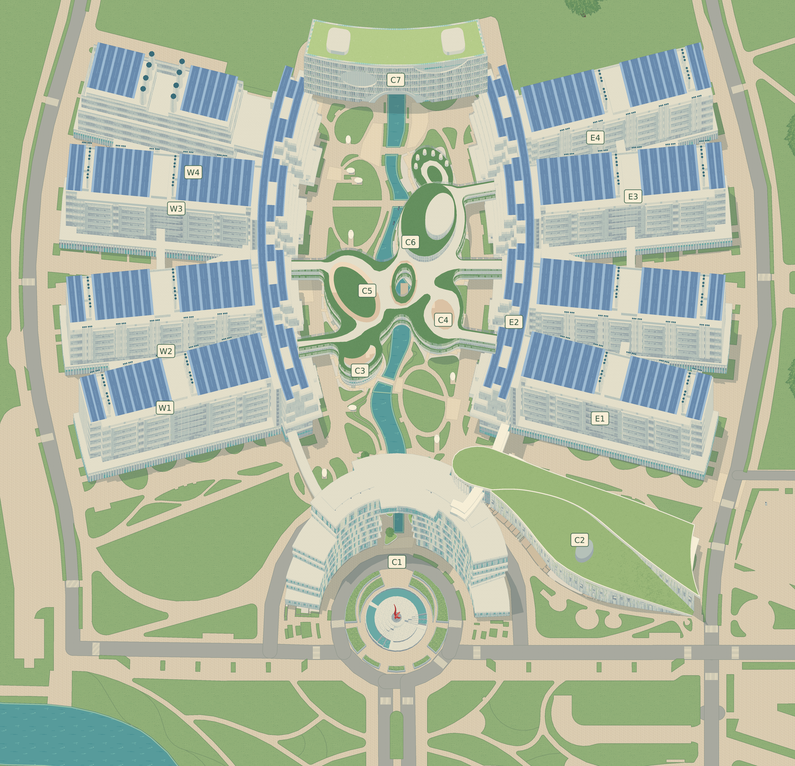
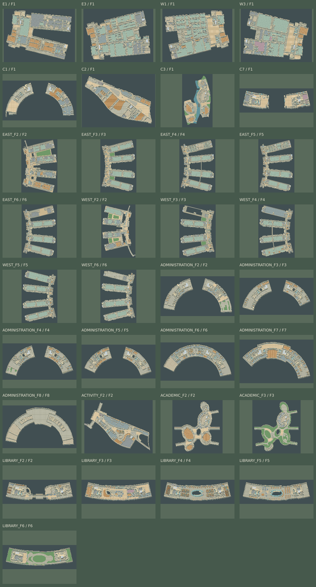

# 地图详细解包与重建报告

日期：2026-11-03（Asia/Shanghai）

程序版本：0.5.0

地图版本：`core-pixel-3d-0.5.0`

## 上一版失真的原因与本次替换

上一版读取了建筑编号锚点，却把每栋建筑替换成 64×64 矩形，并通过 BFS 画出通用步道。原有模型包围框只显示在参考层，建筑曲线、翼楼、连廊、庭院和真实地面没有参与绘制；15 个室内也使用了通用大厅。这不足以重建可辨识的校园。

本次删除这些替代逻辑，重新解析几何与 GLB，建立真实模型烘焙、地形绘制、F1 室内、精细碰撞和实际入口的构建流程。下列图片是可运行地图使用的同一套产物。

## 0.5.0 近景与通行

实际 PNG 密度为每逻辑像素 3×3。地图源几何、人物脚底和交互距离仍在逻辑坐标中。每张室内图同时输出高度图，记录当前最前表面的投影高度，精度为 1/8 逻辑像素。镜头依据可用视口调节。Tiled 图层、地标和物体坐标换算到同一美术像素比例。

15 对同标高连廊由建筑双方的楼层表、标高和邻近端点匹配得到。房门采用房间原名和 entry，检测走廊侧、室内侧及实体墙间隙后才设置门扇。图书馆书柜与座位等源设施保留实物占地。讲台、实验台、边柜属于由地点名称推定的装饰，摆放时避让门槛、梯厅和过道。广场上的池水、石桥及雕塑基座按 43597 号模型的顶视可见三角面区分。逐场景数量、源 ID 与偏差见 `content/map-build-report.json`。

## 0.4.0 室内外统一 3D 像素材质

全部 33 个室内场景已由平面 SVG 配色替换为与室外 GLB 共用的正交软件光栅器。投影仍以原地面坐标为基准，高度向上投影系数 0.55，保留逐三角形 Z-buffer、最近邻材质采样、方向光、暖色调、每通道 8 色值量化及 1px 轮廓。

- 石材地面、混凝土墙体、木质地面和书架、蓝绿色玻璃／织物等按源图层分类，材质纹理在逻辑像素尺寸直接采样，没有通过放大平面图片伪造立体。
- 源多边形外环与孔洞先三角化，生成楼板侧面、剖切墙体与设备实体。房间功能面保留为地板，避免重新变成填满房间的大盒子。墙体剖切显示高度至多 2 个投影单位。
- 所有 869 个带放置矩阵、落在当前室内范围的 GLB 实例均应用原节点层级、XY 放置、UV 与嵌入材质。高度以原局部 Z 为依据，设施剖切显示上限 2.5 个投影单位。22 条不带放置矩阵的 GLB 线型玻璃墙／栏杆依据原中心线挤出，没有猜测未知的沿线模型重复规则。
- 440 片楼梯／扶梯源区域建立逐级踏面与竖向侧面；家具、墙体和设备加入地面接触阴影。上层楼板及天花板不参与当前楼层烘焙。
- 同时输出完整场景 PNG 与原有七个语义图像层；网站继续按需加载当前楼层纹理，不发布原 GLB 或独立源贴图。
- `content/map-build-report.json` 的 `interiors` 记录逐场景源楼层、渲染器、模型要素与 SHA-256、挤出／台阶数量、三角形及最终图像 SHA-256。`public/maps/interior-catalog.png` 汇集全部 33 个室内场景。

新增验证覆盖带孔洞楼板、立面投影、与绘制顺序无关的深度遮挡、真实踏面高度及全部室内产物的尺寸与来源；原来的校园可达、楼梯换层和当前楼层唯一显示检查继续适用。

## 0.3.0 分层、楼层与通道重构

本次重新核对 `data/maps/all-maps.json`，发现旧构建器把楼层固定为 `0`，忽略导航的 `polygon`／`multi-polygon` 与 `-10000` 跨层路网，并把同一实际 F1 翼楼复制为多个互不相通的室内场景。现已替换这些逻辑。

- 范围仍为六组核心建筑和 15 个编号，未扩展停车场、体育馆或校园外边界。
- 覆盖六组建筑的全部 31 个源楼层：东科研楼 F1—F6、西科研楼 F1—F6、行政楼 F1—F8、活动中心 F1—F2、学术中心 F1—F3、图书馆 F1—F6。源楼层键、名称和标高独立保存。
- F1 按真实分离翼楼拆分，其余楼层保留整层连廊，形成 33 个室内场景，含室外共 34 场景。同翼楼编号及 C3—C6 共享实际平面、出入口和探索区。
- 每张地图导出 `base → floor → terrain → rooms → passages → fixtures → walls` 独立图像层；室外 GLB 屋顶为动态上层。原楼层屋顶轮廓保存在隐藏的 Tiled 源参考层，不参与室内碰撞。Tiled 同时保留源图层名、要素编号和孔洞环属性。
- 逐条解读 walk 路网多边形，外环与孔洞保持整体；源公共通道可在功能房间面中恢复通行，但不会覆盖结构墙和水体。折线用于道路参考和通道绘制，不假设其能穿墙。
- 逐条读取 `-10000` 的端点 `region`，保留源楼梯、电梯、扶梯类型，包括非相邻楼层连接。393 条源连接均通过 24px 落点偏移限制，与 15 对室内外入口组成 408 对双向通道。每条源 ID、楼层、类型和偏移见 `content/map-build-report.json` 的 `connections`。
- 校验从校园出生点出发，沿实际碰撞连通分量和换层通道可达全部场景、全部通道、出生／返回点和宝箱，不以给孤立区域添加出生点代替全图可达检查。
- 室内尺寸上限从 64 调整为 128 瓦片，以完整保留东／西高层连廊；实际最大高度 100 瓦片。比例与校园范围不变。
- 游戏将静态图层预合成为地面缓存，只按需加载当前场景及屋顶，并释放上一场景纹理；地图面板使用独立图层，支持逐层开关；室内仅显示角色当前楼层平面并随上下楼同步，室外总览允许预览其他建筑楼层。楼梯以台阶图标和上下楼目标标识，公用落点合并显示双向目标。

验证增加源楼层完整性、393 条连接的类型和方向、全图可达、共享翼楼、多边形孔洞和 Tiled 图层顺序。浏览器通过真实步行到 C2 扶梯，完成 F1→F2→F1，并查看行政楼 F8 平面。

以下原模型解包、坐标、高度及入口来源说明继续适用，文中原有 F1 限制已由上述完整楼层重构替代。

## 一、输入与完整性检查

重新读取并校验 `download-manifest.json` 中全部 125 项文件的字节数和 SHA-256，全部一致。包括 70 个 GLB、54 张外部图片／图标和原 `.bin` 封装。

本次以仓库现有 `all-maps.json` 作为结构化地图输入。原 `h4bjun8x.bin` 约 1.98 MB，是未知二进制封装；本次保留并校验该封装，没有声称重新解码它。其校验值是 `701d1f727e8a612849d1eea767aae858b87d8dbca1e65b0620a088102c494007`。原始封装之前的解码来源见 `data/maps/README.md`；本次可复现链条从该 JSON 与校验通过的 GLB 开始。

所有地图的全部楼层与图层都拆出到本地开发目录，包括不在首版开放的停车场和体育馆，便于全面核对。它们没有因此进入可游玩范围。

| 源地图           | 楼层键数 | 图层数 | 要素数 | 本次游戏用途                         |
| ---------------- | -------: | -----: | -----: | ------------------------------------ |
| `xgkdgz_all`     |        1 |     26 |   2107 | 建筑放置、道路、绿化、水体与外部入口 |
| `xgkdgz_tsg`     |        6 |     80 |   1397 | C7 的 F1—F6 平面                     |
| `xgkdgz_xzbgl`   |        8 |     90 |    672 | C1 的 F1—F8 平面                     |
| `xgkdgz_xshdzx`  |        2 |     34 |    344 | C2 的 F1—F2 平面和入口               |
| `xgkjdxaz_dkyl`  |        6 |     86 |   2407 | E1—E4 的 F1 分离翼楼及 F2—F6         |
| `xgkjdgz_tcc`    |        1 |     13 |   2976 | 仅解包，不开放                       |
| `xgkjdgz_xkyl`   |        6 |     86 |   2702 | W1—W4 的 F1 分离翼楼及 F2—F6         |
| `xgkjdgz_xsyjzx` |        3 |     41 |    515 | C3—C6 的 F1—F3 共享平面              |
| `xgkjdxaz_tyg`   |        1 |     15 |    224 | 仅解包，不开放                       |
| 合计             |       34 |    471 |  13344 | 9 张源地图                           |

逐层保留 GeoJSON 的 `Polygon`／`MultiPolygon`、内环、房间与入口属性；不把环展开成一个错误的多边形。定位信标和定位转换参数未加入网站产物。

## 二、GLB 解包

70 个 GLB 全部完成头部、JSON/BIN chunk、BufferView、Accessor、场景、节点和三角形检查；共 313 个网格、331 个节点、184 张内嵌图像，实例化后共 117656 个三角形。内嵌图像随 GLB 下载，不另计入前述 125 项下载。解包输出包括：

- `scene.gltf`：保留节点层级、矩阵、平移、四元数、缩放、网格与材质引用。
- `buffer.bin`：独立缓冲区。
- `image-*.png/jpg`：从 GLB BufferView 中拆出的内嵌贴图。
- `inventory.json`：逐模型 SHA-256、节点、材质、贴图数量、局部范围和实例化三角形统计。

位置数据按 Accessor 的 componentType、byteOffset、byteStride 读取，支持实际数据使用的整型索引与浮点顶点，并处理规范化整数。逐节点计算 `parent × T × R × S`，保留四元数旋转、负缩放和同一网格的多个实例。东科研楼的 5 个网格被 8 个节点使用，实例化后是 51 个材质分组；不能只渲染这 5 个网格一次。

当前解析器明确拒绝未支持的压缩扩展、稀疏 Accessor、外部缓冲与非三角形图元；本次 70 个文件均不需要这些功能。

## 三、世界坐标与高度

源资料的地面几何为 EPSG:3857。统一原点是 `[12632200, 2618750]`，旋转 30°、Y 轴翻转，室外每个投影单位对应 4 个逻辑像素；按六组核心建筑共同边界平移并保留 128 像素边距。最终室外为 113×109 个 16px 瓦片，1808×1744 逻辑像素。没有重新排列建筑，也没有人工捏造格子道路。

这些 GLB 的局部 XY 是地面，Z 是高度，必须依据实际文件核对，不能直接套用通用导入器的 Y-up 假设。地面位置使用地图要素的列主序 `tarray`。

另一个关键问题是地图要素将目标高度保存在 `height` 字段中，而 `tarray` 的 Z 缩放仍为 1：C1 的局部高度仅约 1.475，地图声明高度约 38.637；直接使用 tarray 会把它压成薄片。构建时以实例化后局部 Z 范围和源 `height` 恢复竖向尺度，保留 XY 放置矩阵，并把模型底面落到地面。每组的实际矩阵与烘焙范围都写入构建报告。

| 建筑组             | 总图要素 ID | 保留的主要外观                                   | 源声明高度（投影单位） |
| ------------------ | ----------: | ------------------------------------------------ | ---------------------: |
| 东科研楼           |       45963 | 四条倾角不同的翼楼、弧形长连廊、屋面光伏与外立面 |                 41.158 |
| 西科研楼           |       45962 | 四条翼楼、弧形连廊及与东区不同的节点实例         |                 41.173 |
| C1 行政办公楼      |       43595 | 半环形体量与圆形前广场关系                       |                 38.637 |
| C2 学生活动中心    |       43540 | 曲面绿色屋顶、轮廓、天窗与外部连桥               |                 17.191 |
| C3—C6 学术研究中心 |       43543 | 有机曲线连廊、多个庭院、屋面草地与展厅体量       |                 19.268 |
| C7 图书馆          |       43596 | 横向弧形体量、草地屋顶与天窗                     |                 30.888 |

地理比例不等于实际步行米制比例。室内为了容纳角色碰撞体，统一采用 6px／投影单位，独立视口不会被误当成室外同一比例。

## 四、图像重建

采用确定性的正交软件光栅器。逐三角形投影，重心坐标插值 UV 和深度，读取内嵌材质，执行 Z-buffer 遮挡、柔和明暗、有限色阶量化及 1px 外轮廓。高度向画面上方投影，系数 0.55，保留楼体立面辨识度。

输出六组透明建筑 PNG，而不是向浏览器发布原 GLB。中央连廊和庭院直接来自实际网格，未使用包围矩形涂满它们。源道路中心线的宽度、绿化边缘、水体和斑马线则根据源几何绘制。地图总览使用同一重建图，不再用方块地图代替真实外观。

当前图像是源模型与材质的低分辨率重建，属于本地开发参考；它不是独立手绘像素美术。来源与许可状态记录在 `content/assets.json`。后续可以在这些确定的轮廓上制作独立像素素材，不能再退回统一方盒。

## 五、室内与通行

逐组提取 F1 地面、实验室／办公室、墙体、楼梯、电梯、水体与功能区域。地面外部和孔洞不可行走，房间与墙体按真实形状阻挡；公共走廊保持通行。

E/W 一层分别存在两片分离的实际地面，按照编号房间锚点确定所属翼楼，裁取相应范围；没有把分离翼楼强行合并成一座通用大厅。其他建筑也采用其实际 F1，而不是统一 32×24 房间。F1 室内仍在 64×64 瓦片内，高层整层连廊按真实范围扩展至 128×128 上限。

4px 碰撞网格由这些多边形生成。源玻璃墙中的 LineString 保留原中心线；未提供宽度时，采用已记录的 4px 保守碰撞宽度，保留源门洞与庭院。角色按 0.22m 脚底半径校准（见[角色比例说明](character-scale.md)），校验整个碰撞体覆盖的网格，构建时验证入口、返回点、探索区、纸条预留区和 12 个宝箱点的连通性。Tiled 中将同一占用网格导出为逐行合并矩形，测试会完整还原矩形并逐格比较，避免另做一套不一致的碰撞。

屋顶在角色进入相应地面轮廓或靠近入口时淡化，显示角色所在的公共空间。建筑编号仅作为标注，不再承担建筑几何。

## 六、入口依据与误差

优先使用可明确识别的 F1 入口：C2 采用一层入口要素 72730，C7 采用总图标明的图书馆西侧一楼入口 53762。C3/C4 采用各自演讲厅要素的入口；C5/C6 采用对应 POI 的入口；E/W 从源建筑组入口候选中按编号锚点距离分配，保留来源索引。

源点可能正好位于墙线或细小障碍上，因此在真实公共连通空间中选择最近安全点，不修改墙体或画出新路。单入口吸附上限为 48px，超出会导致构建失败。目前室外最大偏移约 **2.74px**，室内最大约 **9.20px**；每个入口的原始坐标、所选索引、显式要素 ID 和偏移均写入 `content/map-build-report.json`。

E/W 的编号与具体入口关联仍为自动推导，尚无现场核实；这一限制不会被误标为精确实测。

## 七、验证与边界

执行 `npm run maps:unpack`、`maps:inspect`、`maps:verify` 可复现解包、平面检查和重建。测试覆盖所有 GLB、变换、高度、孔洞、几何规则、入口和精确碰撞导出。浏览器使用实际按键沿真实 C2 公共走廊完成进入、探索和返回，不注入坐标跳过墙体。

保留的限制：外边界仍是六组核心建筑的有限包络；全部源楼层开放公共通道，房间功能面仍按公共探索碰撞规则处理；源编号入口关联仍待现场确认；独立像素美术与多人服务尚未完成。源 `.bin` 未重新解码，输入范围已在本报告开头明确。

格式依据：[Khronos glTF 2.0](https://registry.khronos.org/glTF/specs/2.0/glTF-2.0.html)、[Tiled JSON](https://doc.mapeditor.org/en/stable/reference/json-map-format/)。校园数据导出器的 Z 高度和独立 `height` 规则，是本次检查本地文件所得的适配结论。
