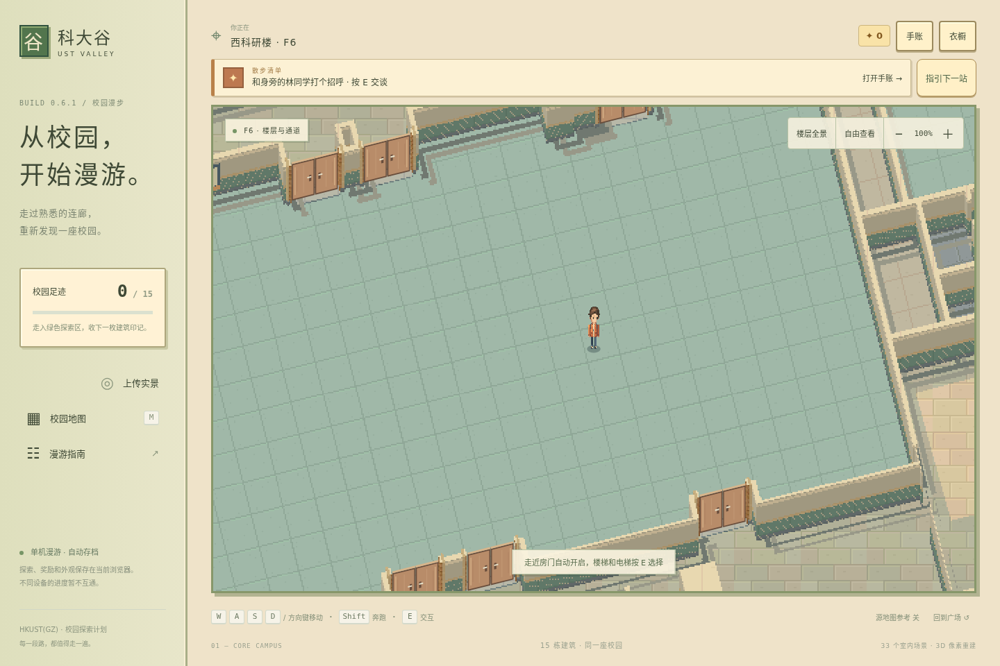
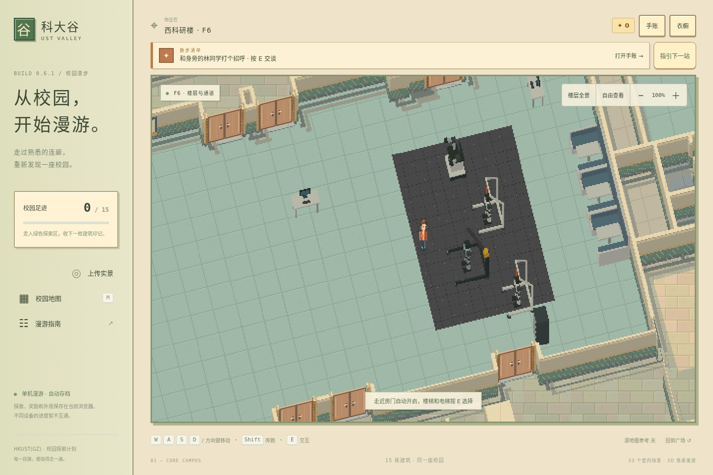

# W1 六楼机器人实验室：首次照片重建

本次根据照片 `dbc1455a-4945-4884-81f0-ee623bd989c0` 的六楼点位和朝向，在现有实验室（源特征 `620722`）中补充可辨认陈设。上传者确认卡座需贴东墙、面对面并相连，地垫已相对首稿旋转 90°。其余重建采用近似摆放与常见物件尺寸，后续照片沿用实例 ID 更新，不宣称完成测量或相机标定。

基线：`8a2db33092c02b982d81c707339d157d31cf8493`。批次：`cfbe514a-45f9-4f3e-a395-c841ee8689f3`。仅提交审核，不自动合并或部署。

| 陈设 | 数量 | 像素表达 |
| --- | ---: | --- |
| 人形机器人 | 3 | 黑色头部、面罩、胸甲、关节、手臂、腿与脚；其中一台银色 |
| 双臂移动机器人 | 1 | 轮式底盘、机身、双机械臂、夹爪、立杆屏幕与散热口 |
| 保护架／起吊架 | 3 | 白色保护架、黑色悬臂、黄色绞盘、吊带、底座和脚轮 |
| 蓝色软包卡座 | 3 | 贴东墙连续相连，每组面对面双座、中间桌面、蓝色软包和共用隔板 |
| 工作台 | 2 | 桌腿、台面、显示器和键盘 |
| 设备柜 | 1 | 深灰柜体、分层抽屉及把手 |
| 实验地垫 | 1 | 沿东墙方向旋转的深灰橡胶拼接缝和少量颗粒 |

## 游戏画面对照

两张截图使用同一视口、角色位置、镜头和缩放；不包含实景照片。

| 修改前 | 修改后 |
| --- | --- |
|  |  |

场景 `interior_west_f6`，角色／跟随镜头 `(590, 1100)`，1440×960 视口，100% 缩放。私有验收目录另保存 150% 近景和楼层全景。

## 实现与验证

- 实例配置：`src/shared/photo-props.ts`，稳定 ID、所属场景、位置、旋转、估计尺寸。
- 原创几何：`scripts/photo-prop-art.ts`，实际参与室内烘焙、人物遮挡高度图和局部碰撞生成；不使用私有原图作贴图。
- 保留原有墙体、房间轮廓、门洞、楼层连接和结构碰撞；给物件周围及门口留出通路。
- `tests/photo-props.test.ts` 检查楼层与房间归属、占地避障、落地与高度、实体碰撞及原有路径可达性。
- `tests/browser/fixtures.spec.ts` 验证角色向吊架行走被阻挡，随后能绕开设备。
- 使用 `photo-rebuild verify` 执行地图可复现构建、单元测试、类型与生产构建、浏览器入口／设施／镜头回归及结构和隐私检查。最终结果保存在对应批次的验证报告和回执中。

近似位置和尺寸可随新照片修改；未加入开顶剖视中会遮挡设备的天花风管／灯条，以及无法可靠辨认的前景残缺设备和小字。室内仍使用现有立体像素剖视；没有新增室内实时自由旋转渲染器。

原图、预览、拍摄信息及逐项完整证据保留在受控资料目录。照片在本审核分支合入并由管理员确认前，不标为“已用于重建”。
