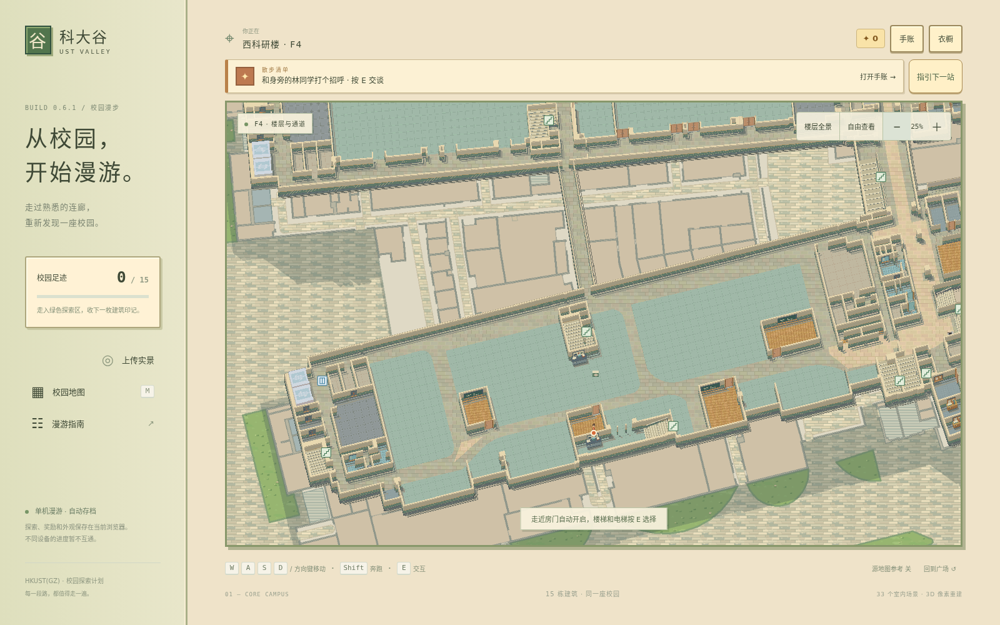
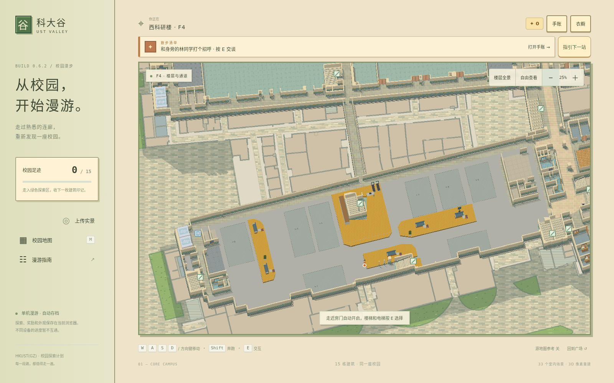
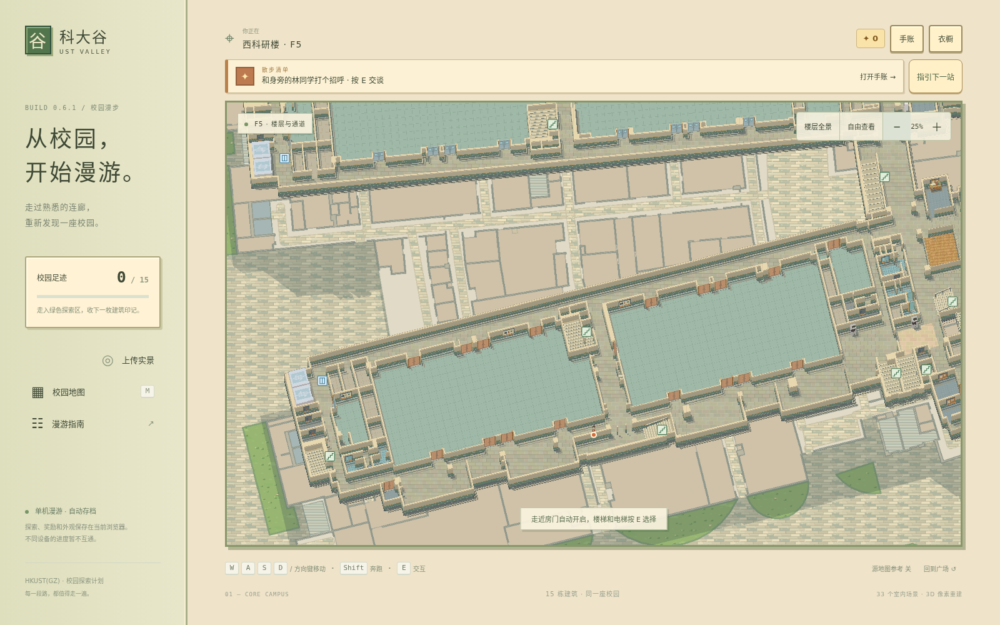
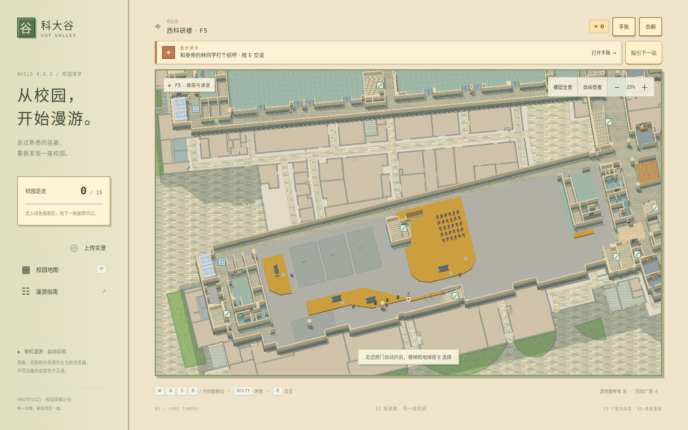
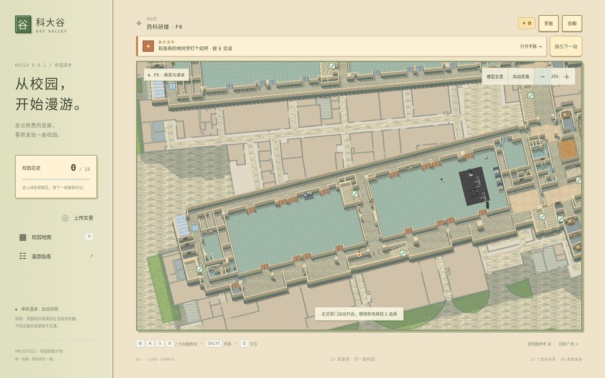
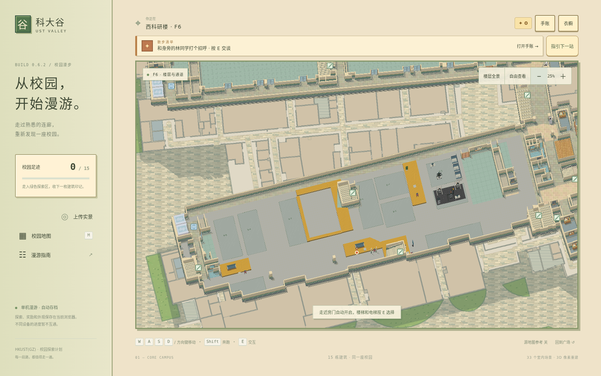
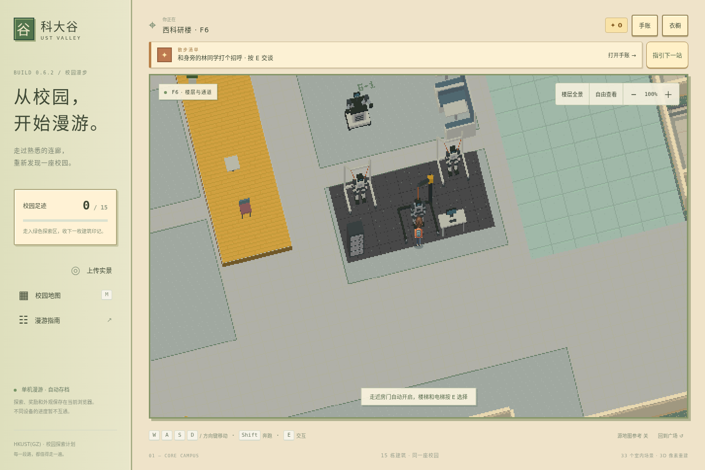

# W1 4–6 楼开放布局与地台

本次按维护者提供的三张楼层图调整 W1 的 4、5、6 楼。工作区和共享区采用开放布局，移除原先推定的内部分隔墙、门及对应阻挡；原始地图的楼板、挑空、外沿、楼梯、电梯和跨层连接保留。两侧大块白色区域按维护者要求保留现状。

图中的黄色和橙色均表示约 **0.30 米高的地台**。游戏中为其生成带侧面的立体平台，并用暖色铺装、细边线和小尺度纹理表达高度；角色进入平台后，脚底、影子和遮挡计算随支撑面同步抬高。平台可直接迈上、迈下。

## 分层调整

| 楼层 | 布局与设施 |
| --- | --- |
| 4F | 8 个编号工作区；西侧条形、中部及东侧共享地台；布置休息座椅、桌台、运动设施和绿植。 |
| 5F | 4 个编号工作区；西侧休息平台、中央活动平台和南侧带状平台；中央设置 5 × 6 座椅阵列。 |
| 6F | 10 个编号工作区；中部与南侧共享地台；机器人、支架、地垫和连体卡座放在维护者红框指定的东侧 6-1、6-2 区域，卡座沿该区域东侧连续排列。 |

工作区编号是地面提示，不生成围墙或门。家具采用程序化像素模型，碰撞与可见占地同步生成，并检查入口和既有通路。

## 游戏内对照

以下仅展示游戏场景。原始参考图包含个人信息，未纳入公开仓库。

### 4F

调整前：

调整后：

### 5F

调整前：

调整后：

### 6F

调整前：

调整后：

东侧设备区近景：

## 尺寸与保留范围

平面图按 W1 原地图的长轴与楼层坐标进行近似对齐，未将示意图视作精确测绘。地台高度采用维护者明确给出的 30 厘米；其边界及家具位置可随后续实景照片继续校正。家具与平台的材质表达也可继续细化。

修改前后截图使用相同场景、角色位置、窗口尺寸和缩放。校验保留原楼板与孔洞、跨层连接和其他建筑场景，检查工作区通路、家具落地与碰撞、旧门残留、平台行走高度和导出数据一致性。

本次成果已汇入共享审核分支 `photo-rebuild/review`（原交付分支 `layout/w1-open-floors` 保留历史），基线为 `19dde0139e40bb05b9263ca7454accff144395ab`，地图版本为 `core-pixel-3d-0.6.2`。不自动合入或替换原网站。

## 验证结果

- 全量单元检查：93 项通过。
- 浏览器检查：12 个用例通过，覆盖地台上下、设备碰撞、自动门、建筑入口与镜头；设备移到东侧后另外复测 W1 F6 碰撞用例，通过。
- 范围核对：其余 31 个场景数据与基线一致；三层原楼板、孔洞和跨层连接保持一致。
- 共移除 42 扇开放区旧门；18 组平台高度均为 0.30 米。
- 设备整组的 14 件物体全部位于维护者红框指定的 6-1、6-2 区域；连体卡座沿东侧排列。
- 地图重新生成的一致性、类型检查及生产构建均通过。
